<p align="center">
  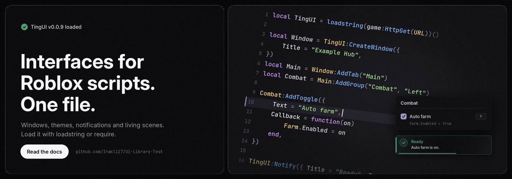
</p>

<p align="center">
  
  
  
  
  
</p>

<p align="center">
  <a href="docs/getting-started.md"><b>Get started</b></a> &nbsp;·&nbsp;
  <a href="docs/elements.md"><b>Elements</b></a> &nbsp;·&nbsp;
  <a href="docs/themes.md"><b>Themes</b></a> &nbsp;·&nbsp;
  <a href="docs/layouts.md"><b>Live reload</b></a> &nbsp;·&nbsp;
  <a href="docs/configs.md"><b>Configs</b></a> &nbsp;·&nbsp;
  <a href="docs/executors.md"><b>Executors</b></a> &nbsp;·&nbsp;
  <a href="docs/changelog.md"><b>Changelog</b></a>
</p>

TingUI is a dark, compact UI library for Roblox in a single Luau file. It loads with `loadstring` on an executor, or drops into any game as a ModuleScript. It has no dependencies and doesn't touch your game's hierarchy. Its themes go further than colours: each one changes the shape, glow, font, lighting and motion, and the newest ones bring whole animated scenes that react to you.

> [!NOTE]
> **Lumen is now TingUI.** Old `Lumen.lua` links keep working and load TingUI with the same options. Configs saved by Lumen are picked up automatically. Point your link at `TingUI.lua` whenever it suits you.

## Quick start

```lua
local TingUI = loadstring(game:HttpGet("https://raw.githubusercontent.com/Irakli17/Ui-Library-Test/main/TingUI.lua"))({ Id = "MyHub" })

local Window = TingUI:CreateWindow({ Title = "My Hub", Tag = "Pro", Version = "v0.0.8", Snow = true })
local Tab = Window:AddTab("Main")
local Group = Tab:AddGroup("Hello")

Group:AddToggle({ Text = "Enabled", Flag = "Enabled" }):AddKeybind({ Default = Enum.KeyCode.F })
Group:AddSlider({ Text = "Speed", Min = 0, Max = 100, Default = 50, Flag = "Speed" })
Group:AddButton({ Text = "Hello", Callback = function() TingUI:Notify("Hi!") end })

Window:AddConfigTab("Config")
```

<details>
<summary><b>In a Roblox game (ModuleScript)</b></summary>

<br>

Put `TingUI.lua` in **ReplicatedStorage** as a ModuleScript named `TingUI`, then require it from a LocalScript:

```lua
local TingUI = require(game:GetService("ReplicatedStorage").TingUI)
TingUI:Configure({ Theme = "Ocean" })
local Window = TingUI:CreateWindow({ Title = "My Game" })
```

Requiring it on the server gives a clear error instead of a broken UI. See [Getting started](docs/getting-started.md#in-a-roblox-game).
</details>

<details>
<summary><b>With Rojo or Wally</b></summary>

<br>

```toml
# wally.toml
[dependencies]
TingUI = "irakli17/tingui@0.0.8"
```

With Rojo, `default.project.json` maps `TingUI.lua` as the package. `rojo serve dev.project.json` builds a test place with TingUI, a DataStore config server and a small demo.
</details>

<details>
<summary><b>The sturdier executor loader</b></summary>

<br>

`Loader.lua` tries GitHub, then the jsDelivr mirror, then a copy cached on disk. It returns `nil, err` instead of crashing your script, and it can pin a release:

```lua
local TingUI, err = loadstring(game:HttpGet("https://raw.githubusercontent.com/Irakli17/Ui-Library-Test/main/Loader.lua"))()({
	Id = "MyHub", Version = "v0.0.8-stable",
})
if not TingUI then return warn(err) end
```
</details>

## New in v0.0.8

<table>
  <tr>
    <td width="50%" valign="top">

**Notifications you can act on**

Cards now carry live progress bars, an **Undo** that counts down, a **reply box**, folded **details** with a **Copy** button, pictures, and styled buttons. Repeats merge into one card with a x3 counter. Hover for pin and close, drag a card sideways to fling it away, and open the history from the bell in the dock. Eight new types each have their own animated icon. [Read more](docs/elements.md#notifications)


</td>
    <td width="50%" valign="top">

**Ocean comes alive, Serotonin arrives**

Ocean's window now floats in water. Waves roll along its bottom and rise toward your cursor, a tide washes over it when you switch to it, and clicks drop ripples. No two bubbles are alike, and they pop at depth, at the surface or when you touch them. **Serotonin** is a crisp, square, teal cheat-menu look. Glass got real lens bokeh, and the tab bar now always fits, whatever the font.

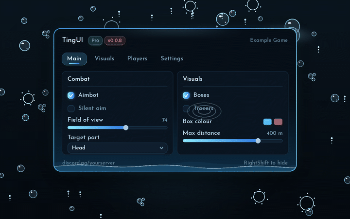

</td>
  </tr>
</table>

## New in v0.0.7

<table>
  <tr>
    <td width="50%" valign="top">

**The Shell: one desktop for every script**

Run three TingUI scripts and you get one dock, not three. The first script hosts and gives every other script a taskbar button with a live status dot. Ctrl+K searches every setting in every script, notifications share one stack and say who sent them, and two scripts on one menu key get a notification that fixes it in one click. It's automatic. [Read more](docs/shell.md)


</td>
    <td width="50%" valign="top">

**Live reload**

Describe a window as one table, mount it from a file, and every save updates the open UI in place. Values, keybinds and the open tab stay put, and a broken save keeps the last good version and tells you which line is wrong.

```lua
TingUI:MountFile("MyHub/layout.lua", handlers)
```

[Read more](docs/layouts.md)

</td>
  </tr>
  <tr>
    <td colspan="2" valign="top">

**Theme Studio and share codes**

A window for making themes, with every colour and style key live on your real UI, contrast checks with a one-click fix, and your themes saved for every script. A finished theme becomes a `TUI1:` code that anyone can paste to install. Codes are data only, so they're safe to take from strangers. [Read more](docs/theme-studio.md)

<p align="center"></p>

</td>
  </tr>
</table>

## Living scenes

Three themes ship a scene: animated artwork drawn in and around the window that reacts to clicks, tab switches and the window opening. Everything is built from plain frames, with no asset uploads, so the scenes work in every executor and every game.

<table>
  <tr>
    <td width="33%"><a href="docs/themes.md#hologram-scene">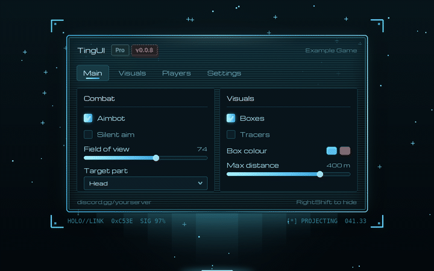</a></td>
    <td width="33%"><a href="docs/themes.md#circuit-scene">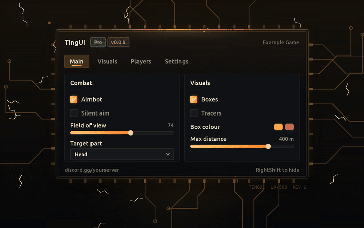</a></td>
    <td width="33%"><a href="docs/themes.md#ocean-scene"></a></td>
  </tr>
  <tr>
    <td><b>Hologram</b><br><sub>Brackets lock on as it opens, a scan line sweeps each page and clicks ripple out as hexagons.</sub></td>
    <td><b>Circuit</b><br><sub>The window is a chip. Current races down copper traces, and every click fires a burst.</sub></td>
    <td><b>Ocean</b><br><sub>Waves that rise toward your cursor, a tide on switching, click ripples and bubbles that pop.</sub></td>
  </tr>
</table>

## Every theme

<table>
  <tr>
    <td width="33%"><a href="docs/themes.md#lavender">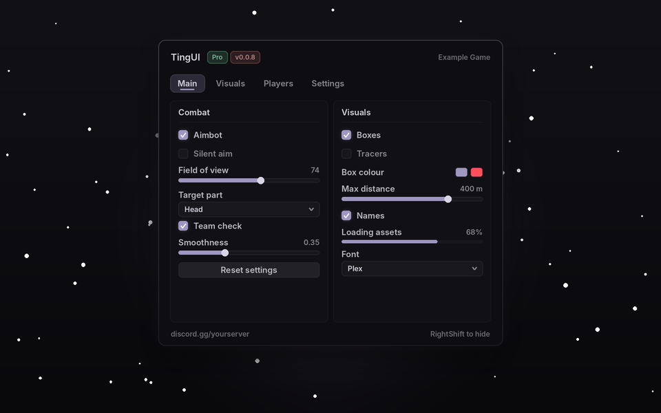</a><br><b>Lavender</b> <sub>(default)</sub><br><sub>Soft lilac, snow.</sub></td>
    <td width="33%"><a href="docs/themes.md#ocean">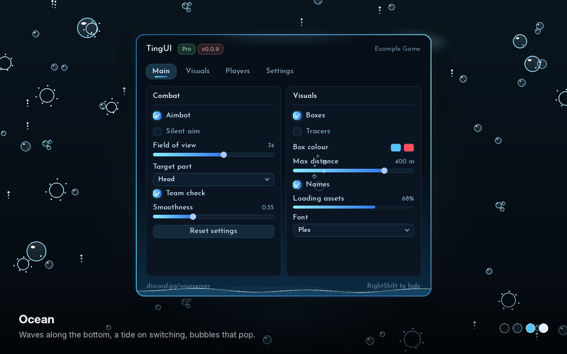</a><br><b>Ocean</b><br><sub>Living waves, a tide, popping bubbles.</sub></td>
    <td width="33%"><a href="docs/themes.md#rose">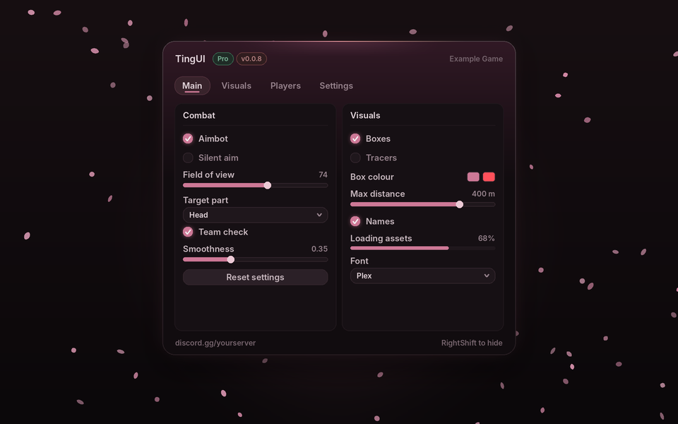</a><br><b>Rose</b><br><sub>Extra round, drifting petals.</sub></td>
  </tr>
  <tr>
    <td><a href="docs/themes.md#sunset">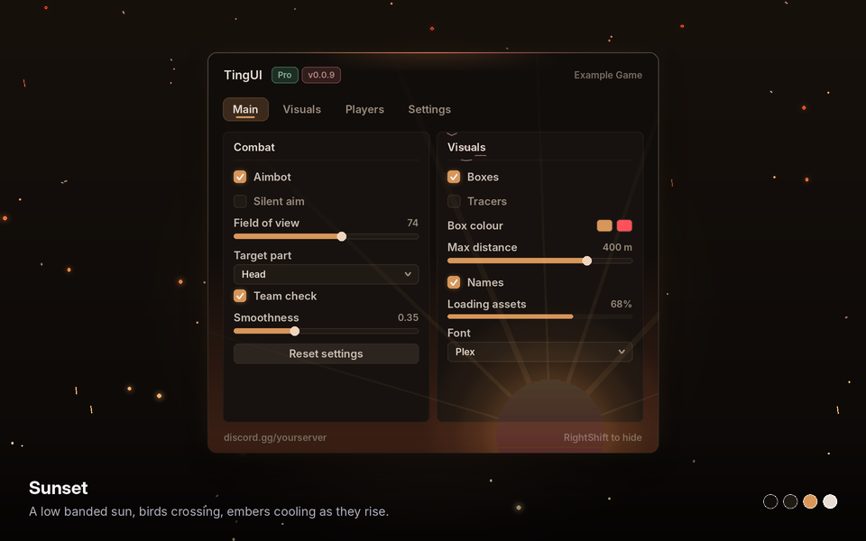</a><br><b>Sunset</b><br><sub>Warm glow, rising embers.</sub></td>
    <td><a href="docs/themes.md#mono">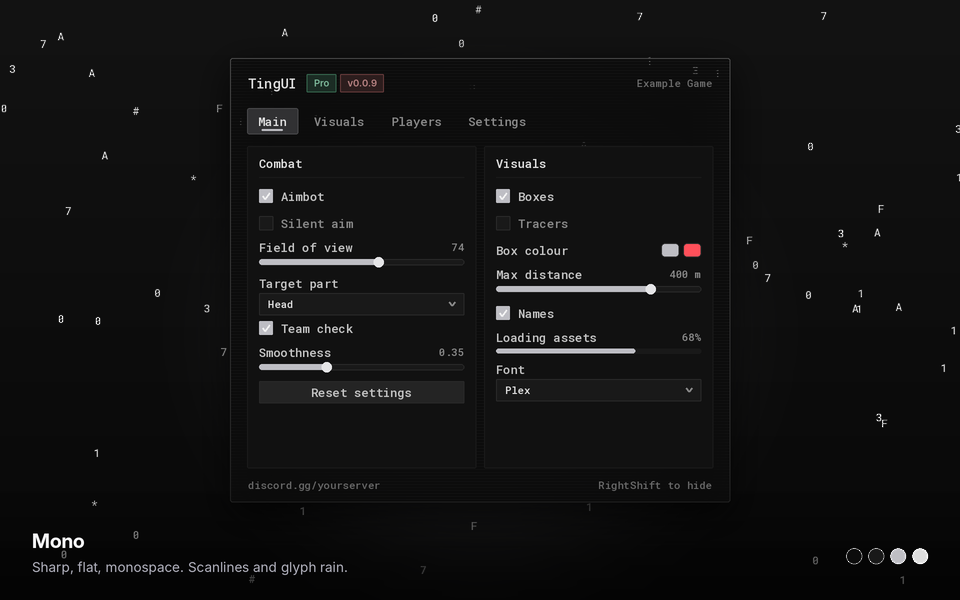</a><br><b>Mono</b><br><sub>Monospace, scanlines, glyph rain.</sub></td>
    <td><a href="docs/themes.md#frost">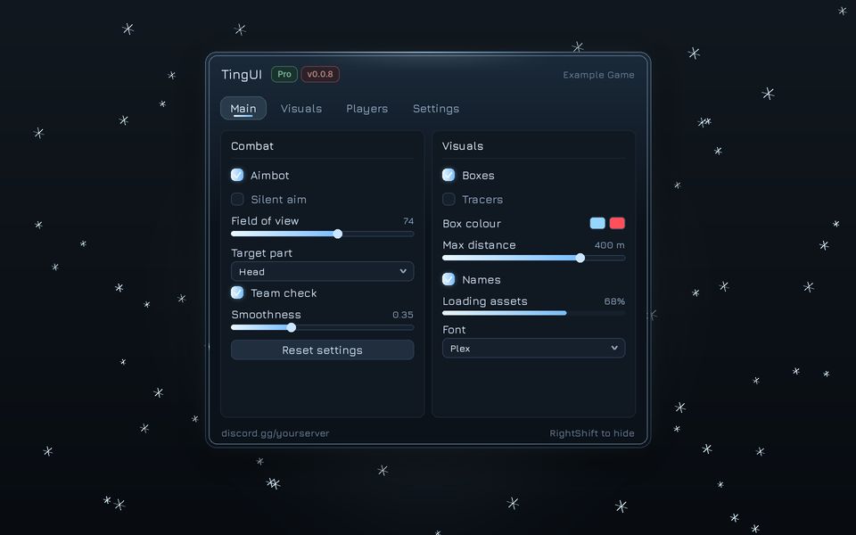</a><br><b>Frost</b><br><sub>Pale ice, frosted border, crystals.</sub></td>
  </tr>
  <tr>
    <td><a href="docs/themes.md#royal">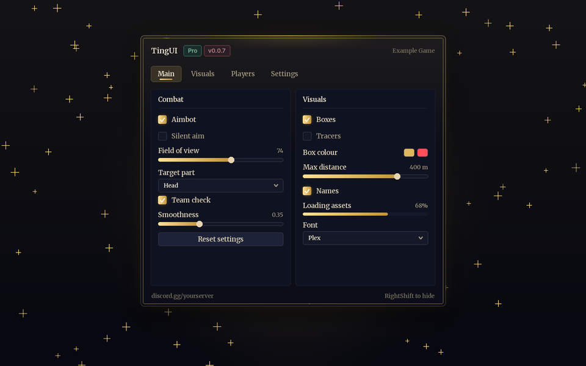</a><br><b>Royal</b><br><sub>Navy and gold, serif, gilded border.</sub></td>
    <td><a href="docs/themes.md#serotonin">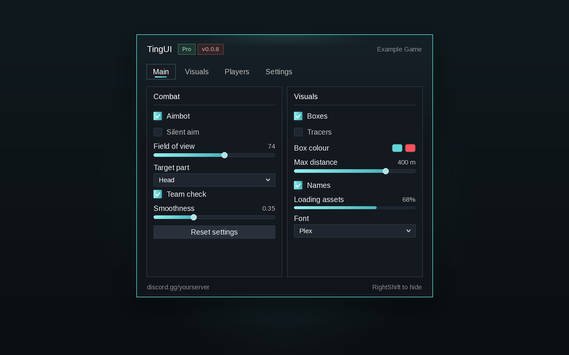</a><br><b>Serotonin</b><br><sub>Square, teal outline, no particles.</sub></td>
    <td><a href="docs/themes.md#cosmos">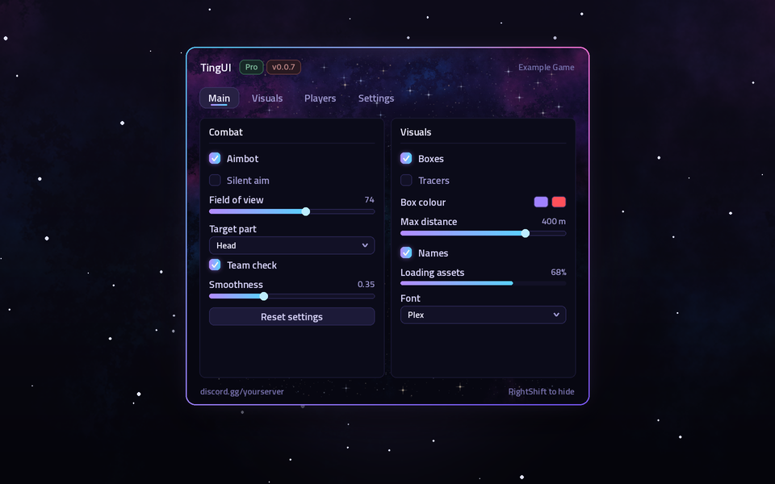</a><br><b>Cosmos</b><br><sub>Nebula art, aurora border, comets.</sub></td>
  </tr>
  <tr>
    <td><a href="docs/themes.md#storm">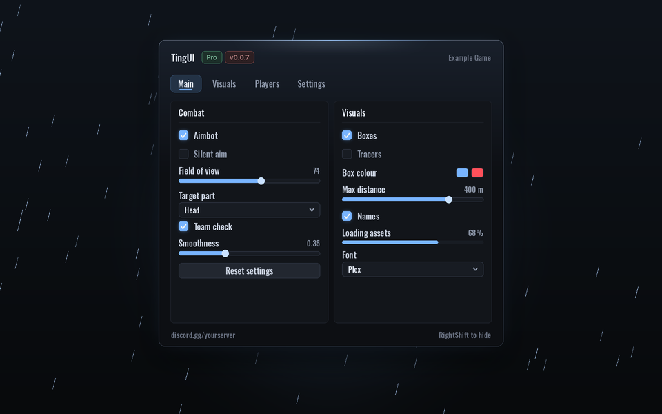</a><br><b>Storm</b><br><sub>Steel, slanted rain, lightning.</sub></td>
    <td><a href="docs/themes.md#blueprint">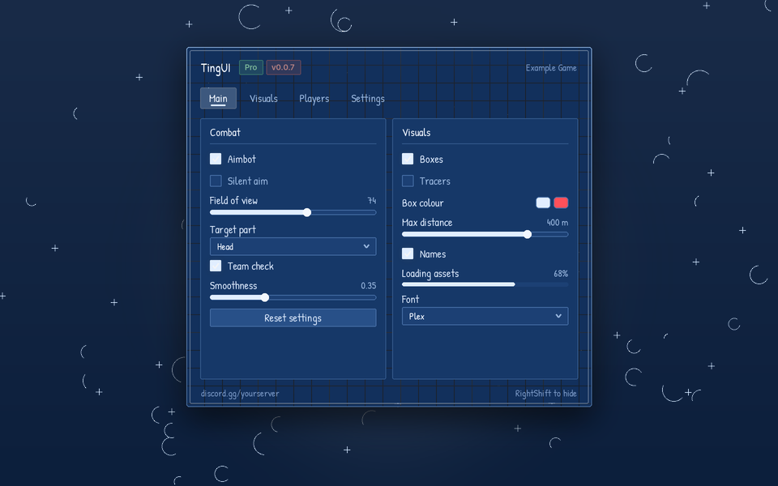</a><br><b>Blueprint</b><br><sub>Drafting grid, handwritten labels.</sub></td>
    <td><a href="docs/themes.md#hazard">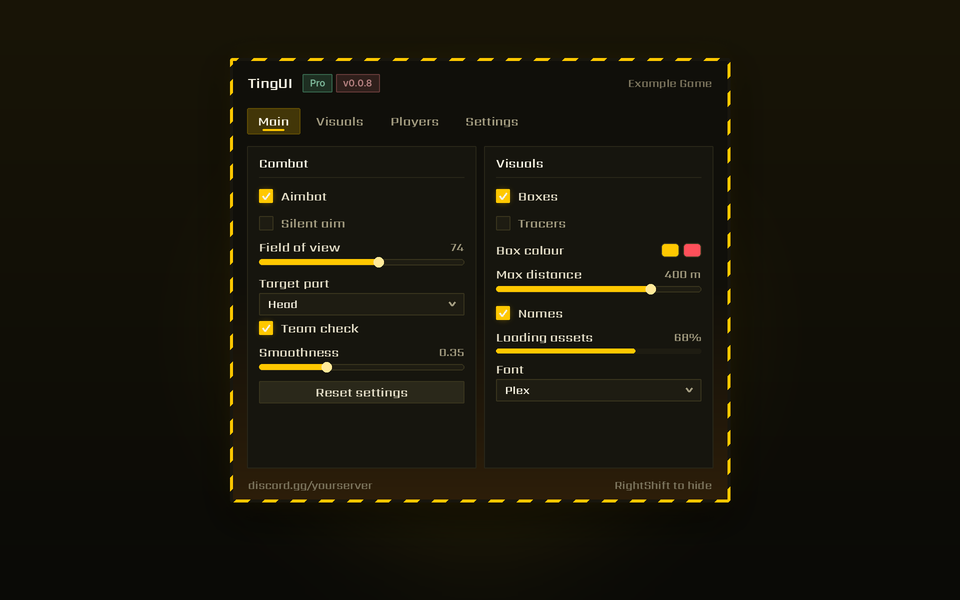</a><br><b>Hazard</b><br><sub>Warning-tape border, square corners.</sub></td>
  </tr>
  <tr>
    <td><a href="docs/themes.md#glass">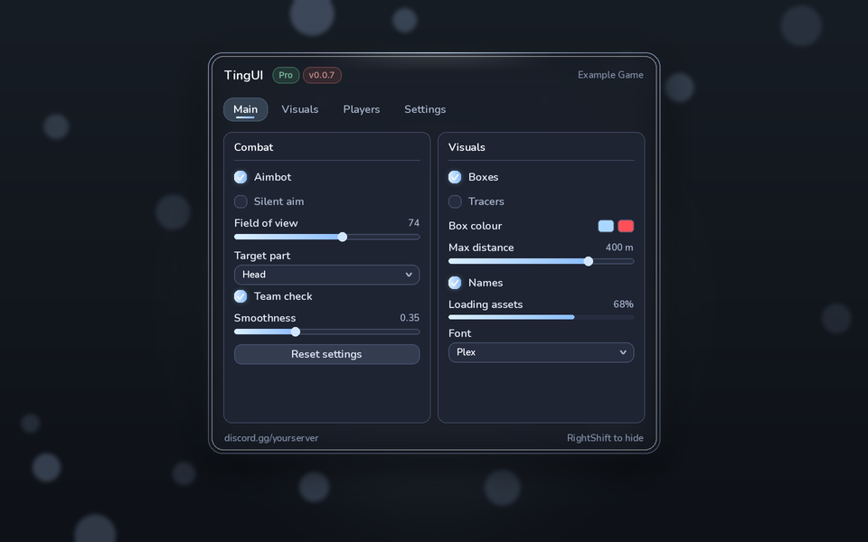</a><br><b>Glass</b><br><sub>Frosted see-through surfaces, lens bokeh.</sub></td>
    <td><a href="docs/themes.md#hologram">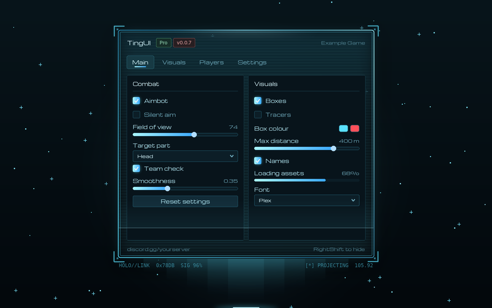</a><br><b>Hologram</b><br><sub>A cyan projection with a live scene.</sub></td>
    <td><a href="docs/themes.md#circuit">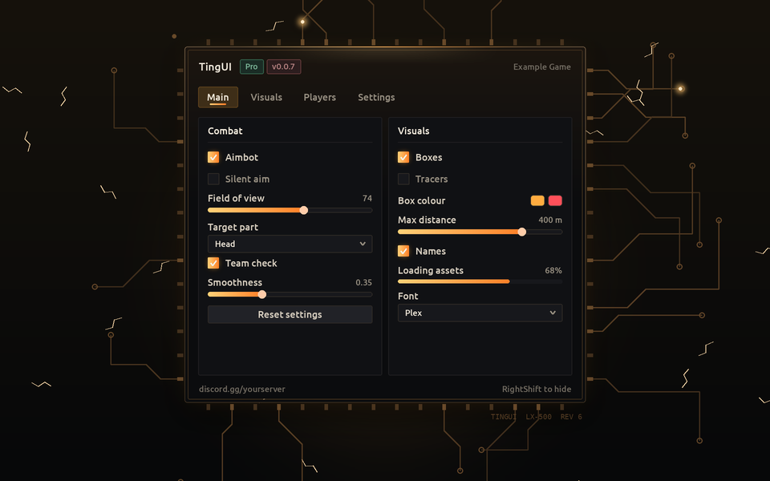</a><br><b>Circuit</b><br><sub>A chip on a board with a live scene.</sub></td>
  </tr>
</table>

Switching themes blends everything at once: colours, corner shapes, glow, fonts, lighting, particles and scenes. `TingUI:RegisterTheme` and `TingUI:RegisterScene` let you add your own. See [Themes](docs/themes.md).

## What's inside

<table>
  <tr>
    <td width="50%" valign="top">

**Drops into anything**
- One file, no dependencies, nothing needed from your game's hierarchy
- `loadstring` with options, or `require` with options from attributes or `Configure`
- `TingUI.new` gives you fully independent instances
- Rojo and Wally ready, with a Studio demo
- Configs in executor files, in memory, in a DataStore or through your own adapter

</td>
    <td width="50%" valign="top">

**Stays put in any project**
- The UI keeps its size even when another script inserts a `UIScale`
- Windows keep their size when you require TingUI before the screen is ready
- The menu key never triggers shift lock, whether it's RightShift or LeftShift
- Each script gets its own config folder, so one script's settings never leak into another's
- Old links and old configs keep working across releases

</td>
  </tr>
  <tr>
    <td valign="top">

**Every element you need**
- Toggles, sliders you can type into, dropdowns with search and multi-select, a player dropdown
- Inputs, buttons with confirm dialogs and sub-buttons, progress bars, paragraphs and images
- 3D viewport with ESP overlay and highlight
- Keybinds, colour pickers and credits
- Hover explanations everywhere, plus a command palette (Ctrl+K) that finds any setting

</td>
    <td valign="top">

**Motion with manners**
- A sliding tab pill and page transitions
- Unfolding dropdowns, ripples on buttons, and a different motion for each notification type
- Theme scenes that answer the player
- **Reduce motion** holds everything still with one toggle
- Every callback runs in `xpcall`, so an error in your code shows a notification instead of breaking the UI

</td>
  </tr>
  <tr>
    <td valign="top">

**Built to iterate**
- `TingUI:Mount(layout)` builds a whole window from one table or JSON
- `ui:Update(layout)` changes only what changed and keeps every value
- Live reload from a file, a StringValue or a function
- Clear errors that point at the exact element, with "did you mean"

</td>
    <td valign="top">

**Plays well with other scripts**
- One shared dock with a taskbar, one palette, one notification stack
- Menu key clashes spotted and fixed with one click
- Hand your theme to every script at once
- `Shell = false` keeps a script to itself

</td>
  </tr>
</table>

## Documentation

| Page | What's in it |
|---|---|
| [Getting started](docs/getting-started.md) | Loading on executors and in games, every load option, your first window |
| [Windows and layout](docs/windows.md) | Windows, tabs, groups, panels, dock, HUD, command palette, menu keys |
| [Elements](docs/elements.md) | Every element and addon, hover explanations, dialogs, notifications |
| [Themes](docs/themes.md) | The 15 presets, scenes, particles, textures, fonts, scale, making your own |
| [Configs](docs/configs.md) | The config tab, saving and loading, storage adapters, DataStore, events and flags |
| [Executors](docs/executors.md) | What TingUI uses from your executor, fallbacks, files, re-running scripts |
| [Stability](docs/stability.md) | How TingUI stays the same size and behaviour in any project, and the compatibility promise |
| [Layouts and live reload](docs/layouts.md) | Whole windows from a table or JSON, in-place updates, live reload from a file |
| [Theme Studio](docs/theme-studio.md) | Making themes live, contrast checks, saving, share codes |
| [The Shell](docs/shell.md) | Several TingUI scripts sharing one dock, palette, hotkey list and notification stack |
| [Extending](docs/extending.md) | Your own elements, particles, icons and scenes |
| [Changelog](docs/changelog.md) | What changed in each release |
| [Roadmap](docs/roadmap.md) | Where TingUI is heading next |

[Example.lua](Example.lua) is a full demo of everything. [extras/StudioDemo.client.lua](extras/StudioDemo.client.lua) is a minimal in-game setup.

## Developing

- **Tests.** `sh tests/run.sh` runs TingUI headlessly against a mock Roblox API. It needs the [Luau CLI](https://github.com/luau-lang/luau/releases). It covers require and loadstring loading, every theme and scene, configs through each storage adapter, `TingUI.new`, shift lock, scale stability, the Lumen compatibility path, the Shell, share codes, the Theme Studio, layouts and live reload, the code in these docs and the full `Example.lua`.
- **Images.** Upload the `assets` folder with `TingUI.lua`. The library downloads icons and theme art from the same repo when it needs them and caches them. `tools/build_icons.py` and `tools/build_textures.py` rebuild them.
- **Doc previews.** `python3 tools/build_previews.py` redraws every image in `docs/images` from the presets in `TingUI.lua`, so the gallery always matches the code.

Versions are `vX.X.X`. The current version is **v0.0.8-stable**.
