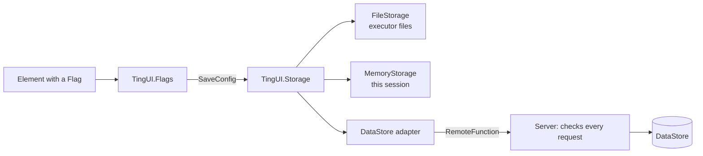

# Configs, events and flags

<sub>[Docs](README.md) › Configs</sub>

- [The config tab](#the-config-tab)
- [Saving and loading](#saving-and-loading)
- [Storage](#storage)
- [DataStore in a real game](#datastore-in-a-real-game)
- [Events](#events)
- [Flags](#flags)

## The config tab

`Window:AddConfigTab(name?, options?)` builds a full settings tab. Everything in it is adjustable, and every setting explains itself on hover.

| Group | What's in it |
|---|---|
| **Menu** | Menu key, dock, watermark, hotkey list, notifications and their position, hover explanations, script error alerts, UI scale, font, screen watermark, unload |
| **Effects** | Particles on or off, particle style, amount and speed, backdrop dim and blur, **Reduce motion** |
| **HUD Positions** | Return-to-place on or off, the delay, which pieces return (dock, hotkey list, watermark), Return now, Set as home |
| **Layout** | Dropdowns for tabs, sections, panels and dock buttons. Tick or untick entries to show or hide them. |
| **Theme** | A preset dropdown with a one-line description of each look, the theme fade time, a colour picker for each theme colour, a reset button, and **Open Theme Studio** with **Use in every script** |
| **Tests** | Each notification type, Loading to Done, action buttons, a deliberate script error and a hold-to-confirm dialog |
| **Configs** | Save, load, delete and autoload |
| **Credits** | Optional: `Window:AddConfigTab("Config", { Credits = { ...entries } })` |

## Saving and loading

```lua
TingUI:SaveConfig("legit"); TingUI:LoadConfig("legit"); TingUI:ListConfigs()
TingUI:DeleteConfig("legit"); TingUI:SetAutoload("legit")
TingUI:LoadAutoload()                -- call once, after building your UI

local code = TingUI:ExportConfig()   -- the current config as a JSON string (share codes, your own saving)
TingUI:ImportConfig(code)            -- and back; returns false + message if it isn't a config
```

Only elements with a `Flag` are saved. The theme preset is saved too, and it's applied before your custom colours when a config loads. Every call returns `true` or `false, message`, so nothing throws. Config names containing `/` or `\` are refused.

**Where configs go.** Each script keeps its configs in its own folder, `TingUI/<Id>`. The default `Id` uses `TingUI`. That way one script's autoload (its theme, UI scale and so on) never lands in another script's UI. Set `Folder` in the load options to choose your own, or set `TingUI.Folder = "MyHub"` before creating the window.

> [!NOTE]
> **Coming from Lumen?** Lumen kept every script's configs in one shared `Lumen` folder. The first time a script using the default folder looks for configs, TingUI copies the old configs and autoload choice into its new folder. The originals stay where they are. Configs saved before the rename also load correctly, including the built-in settings.

## Storage

Configs go through `TingUI.Storage`, an adapter with four functions. Keys look like `"<Folder>/<name>.json"`, and values are strings.

| Adapter | Used when |
|---|---|
| `TingUI.FileStorage` | The executor has `writefile`, `readfile`, `isfile`, `isfolder`, `makefolder` and `listfiles`. This is the default there. |
| `TingUI.MemoryStorage` | Anywhere else. Configs work for the session and reset when the player leaves. |
| Your own | `TingUI:SetStorage(adapter)` or the `Storage` load option. |

```lua
TingUI:SetStorage({
	Name = "Mine", Persistent = true,
	Read = function(key) return savedString or nil end,
	Write = function(key, value) end,
	Delete = function(key) end,
	List = function(folder) return { "MyHub/legit.json" } end,   -- keys or bare file names
})
```

Adapter functions may yield (a `RemoteFunction` call, for example) and may `error("message")`. The message is what the player sees.

Themes saved from the [Theme Studio](theme-studio.md#saving-and-your-themes) go through the same adapter, under `"<ThemeFolder>/<name>.tui"` (`TingUI/themes` by default). Any adapter that stores configs stores themes too.



## DataStore in a real game

`extras/DataStoreStorage.lua` ships both halves. It keeps each player's configs under one DataStore key and checks every request on the server: key and value sizes, a cap of 40 entries and a short write cooldown. Outages come back as readable errors.

```lua
-- Script in ServerScriptService
require(game:GetService("ReplicatedStorage").TingUIDataStoreStorage).Serve()

-- LocalScript, before building windows
TingUI:SetStorage(require(game:GetService("ReplicatedStorage").TingUIDataStoreStorage).Client())
```

`extras/ConfigServer.server.lua` is that server Script, ready to drop in.

## Events

```lua
TingUI.Events.FlagChanged:Connect(function(flag, value) end)
TingUI.Events.ThemeChanged:Connect(function(theme) end)
TingUI.Events.StyleChanged:Connect(function(style) end)
TingUI.Events.TabChanged:Connect(function(tabName, window) end)
TingUI.Events.VisibilityChanged:Connect(function(visible, window) end)
TingUI.Events.Notified:Connect(function(options) end)
TingUI.Events.Unloading:Connect(function() end)   -- runs before the UI is removed: restore anything your script changed
```

Each signal has `:Connect(fn)`, which returns a handle with `:Disconnect()`, plus `:Once(fn)` and `:Wait()`. Make your own with `TingUI.Signal()`.

## Flags

```lua
TingUI:GetFlag("Speed")                      -- same as TingUI.Flags.Speed
TingUI:SetFlag("Speed", 50)                  -- moves the slider and fires its callback
TingUI:OnFlagChanged("Speed", function(v) end)
```

`TingUI:Unload()` runs the `Events.Unloading` handlers, then removes everything and disconnects all events. `TingUI.OnUnload = function() end` still works too.

---

**Next:** [Executors](executors.md) · [Stability](stability.md)
