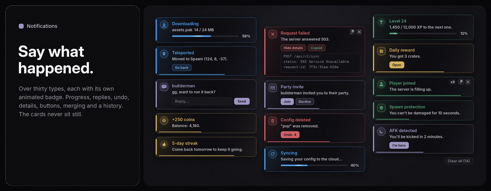

# Elements

<sub>[Docs](README.md) › Elements</sub>

Every element lives in a Group (or a Panel) and takes one options table.

- [Shared options and methods](#shared-options-and-methods)
- [Toggle](#addtoggle) · [Slider](#addslider) · [Dropdown](#adddropdown) · [Player dropdown](#addplayerdropdown) · [Input](#addinput) · [Button](#addbutton)
- [Progress](#addprogress) · [Paragraph](#addparagraph) · [Label](#addlabel) · [Divider and image](#adddivider-and-addimage) · [Image grid](#addimagegrid) · [Viewport](#addviewport) · [Credits](#addcredits)
- [Addons: keybinds and colour pickers](#addons)
- [Hover explanations](#hover-explanations)
- [Confirmation dialog](#confirmation-dialog)
- [Notifications](#notifications)

## Shared options and methods

| Option | What it does |
|---|---|
| `Flag` | Stores the value in `TingUI.Flags[flag]`, registers the element in `TingUI.Options[flag]` and saves it in configs. |
| `Callback` | Runs when the value changes. It runs safely: an error shows a notification instead of breaking anything. |
| `Description` | A hover explanation (see [Hover explanations](#hover-explanations)). `Tooltip` works too. |
| `Disabled` | Start dimmed and non-interactive. |

Every element also has `:OnChanged(fn)`, `:SetVisible(bool)`, `:SetDisabled(bool)`, `:SetDescription(text)`, `:Get()` and `:Destroy()`. Every named element can be found from the [command palette](windows.md#command-palette).

## AddToggle

```lua
local t = Group:AddToggle({ Text = "Fly", Default = false, Flag = "Fly", Risky = false, Callback = function(on) end })
t:Set(true); t:SetText("Fly (fast)"); print(t.Value)
```

`Risky = true` tints the label red. The box squashes and pops when toggled, and the fill fades in, in the theme's accent gradient when it has one. Toggles take [addons](#addons): `:AddKeybind`, `:AddColorPicker` and `:AddTooltip(text)`.

## AddSlider

```lua
Group:AddSlider({ Text = "Speed", Min = 0, Max = 100, Default = 50, Increment = 1, Suffix = " studs", Flag = "Speed" })
```

**Click the value to type an exact number.** Values set from code with `:Set(n)` glide to their spot.

## AddDropdown

```lua
Group:AddDropdown({ Text = "Mode", Values = { "Legit", "Rage" }, Default = "Legit", Flag = "Mode" })
Group:AddDropdown({ Text = "Parts", Values = { "Head", "Torso", "Arms" }, Multi = true, Default = { "Head" }, Flag = "Parts" })
```

Single mode stores a string, and multi mode stores `{[name] = true}`. Use `:Set(v)` and `:SetValues(list, keepSelection?)`. Lists longer than 8 entries get a **search box**; force it with `Search = true` or hide it with `Search = false`.

Opening a dropdown unfolds the list and cascades the rows in. Hovering a row gives it a soft wash, grows a short accent bar on its edge and nudges the label in. Pressing squeezes the row slightly. Picking it flashes the accent, settles into the selected fill with a full-height bar, pops a check mark in and slides the new value up into the field. The chevron turns as the list opens and closes. The list opens below its box when it fits and above it when that fits better; when neither side has room it takes the larger one and shrinks to fit (it scrolls), so it never slides over the box you clicked. It stays attached to the box while the window is dragged or the page scrolls, and closes by itself if the box scrolls out of view.

## AddPlayerDropdown

A dropdown of everyone in the server that updates itself as players join and leave. It takes the same options as AddDropdown, plus `IncludeLocal` (default `false`). `:GetPlayer()` returns the `Player`, or a list in multi mode.

## AddInput

```lua
Group:AddInput({ Text = "Name", Placeholder = "Type here", Default = "", Numeric = false, MaxLength = 32, Flag = "Name" })
Group:AddInput({ Text = "Notes", Dynamic = true, Callback = function(text) end })
```

It fires when focus is lost, or on every keystroke with `Realtime = true`. `.Value` is always current. `Dynamic = true` makes a live text box that grows taller as the text wraps (up to 130 px), fires on every keystroke and submits on Enter.

## AddButton

```lua
local b = Group:AddButton({ Text = "Teleport", Callback = function() end, DoubleClick = false,
	Confirm = { Title = "Teleport?", Text = "You'll leave this server.", Type = "Warning", Hold = 0.6 } })
b:AddSubButton({ Text = "Copy", Callback = function() end })
```

Pressing sends a ripple across the button. `DoubleClick = true` asks for a second click. `Confirm` opens a [confirmation dialog](#confirmation-dialog) first and only runs `Callback` if the player accepts. `:AddSubButton({Text, Callback, Confirm})` splits the row.

## AddProgress

```lua
local bar = Group:AddProgress({ Text = "Loading", Default = 0, Max = 100 })
bar:Increment(10); bar:Set(80); bar:SetMax(200); bar:SetText("Downloading")
```

An animated bar with a moving sheen that brightens briefly when it fills. Without a `Suffix` it shows a percentage. `Color` overrides the accent.

## AddParagraph

`Group:AddParagraph({ Title = "About", Content = "Wrapping text..." })`, or just a string. A titled block of wrapping text with `:SetTitle(t)` and `:SetContent(t)`.

## AddLabel

`Group:AddLabel(text, { Dim, Bold, Box })` with `:SetText` and `:SetColor`. A standalone label supports `:AddKeybind` and `:AddColorPicker`.

## AddDivider and AddImage

`Group:AddDivider()` draws a line. `Group:AddImage({ Image, Height, ScaleType })` shows an image.

## AddImageGrid

```lua
Group:AddImageGrid({ Items = { { Image = "rbxassetid://1", Name = "Skin A" }, { Image = "rbxassetid://2", Name = "Skin B" } },
	Columns = 4, CellHeight = 64, Flag = "Skin", Callback = function(item, index) end })
```

Click a cell to select it, and it gets an accent outline. Use `:Set(i)` and `:SetItems(list)`.

## AddViewport

```lua
local v = Group:AddViewport({ Height = 180, Character = true, Rotate = true,
	ESP = { Box = "Corner", Name = true, Health = 0.8, Distance = true, Color = Color3.fromRGB(255, 80, 110) } })
v:SetESP({ Health = 0.3, Name = "Enemy", DistanceText = "42m" })
v:SetObject(workspace.Model)
```

A 3D preview. With no options it shows a grey block. `Character = true` shows a clone of your avatar, and `Object` takes a Model or BasePart. **Drag to orbit in any direction.** When you let go it eases back to its default tilt and keeps auto-rotating. The mouse wheel zooms. `Rotate = false` turns auto-rotation off; dragging still works.

**ESP preview.** `ESP = {Box = "Full" | "Corner", Name = true | "text", Health = 0-1, Distance = true, DistanceText, Color}` draws an overlay that tracks the model's real on-screen bounds as it rotates. It has a box (a full outline or corner brackets), the name above, a health bar on the left that goes from green to red, and the distance below. `viewport:SetESP({...})` updates it live, and `Color` recolours the box, name and distance smoothly.

**Highlight.** Roblox `Highlight` objects don't render inside ViewportFrames, so TingUI draws its own: a tinted fill over the model plus an outline traced around its silhouette.

```lua
local v = Group:AddViewport({ Character = true, Highlight = { Enabled = true, Fill = Color3.fromRGB(255, 70, 110), FillTransparency = 0.55,
	Outline = Color3.new(1, 1, 1), OutlineTransparency = 0, Thickness = 2 } })
v:SetHighlight({ Enabled = false })          -- fades out
v:SetHighlight({ Outline = Color3.new(0, 1, 0), Thickness = 3 })
```

## AddCredits

`Group:AddCredits({ {Name, Role, RoleColor, Description}, ... })` puts credit cards inside any group. It returns an object with `:Add(entry)`. For a standalone credits panel, see [Key system and credits](windows.md#key-system-and-credits).

## Addons

```lua
local t = Group:AddToggle({ Text = "Fly" })
t:AddKeybind({ Default = Enum.KeyCode.F, Mode = "Toggle", Name = "Fly" })
t:AddColorPicker({ Default = Color3.new(1, 0, 0), Flag = "FlyColor" })
```

**Keybind.** Options: `Default`, `Mode` (`Toggle`, `Hold`, `Press` or `Always`), `Name`, `ShowInList`, `Flag`, `Callback(active)` and `ChangedCallback(key)`. Click the chip to rebind it (Esc clears), and right-click to switch between Toggle and Hold. `Always` is permanently active and needs no key; it shows as `[?]` in the hotkey list. Methods: `:SetKey`, `:SetMode`, `:IsActive` and `:OnKeyChanged(fn)`.

**ColorPicker.** Options: `Default`, `Flag` and `Callback(color)`, plus `:Set(color)`. It has a hue bar, a saturation and brightness square and a hex input, and the swatch glows in its own colour.

## Hover explanations

Rest the mouse on anything with a `Description` (or `Tooltip`). After a short pause, a card fades and slides in **beside the window, panel or dock it belongs to**, never on top of what you're about to click. If there's no room on either side, it sits beside the element, then below it, and always clear of the element itself. Moving to another explained element makes the card glide over instead of popping again, and leaving fades it out. Every setting in the config tab has one.

```lua
Group:AddToggle({ Text = "Fullbright", Description = "Lights the whole map evenly so dark areas are visible." })
someElement:SetDescription("Changed text")
TingUI.HintDelay = 0.35   -- seconds before it appears
TingUI.Hints = false      -- turn them all off (also in the config tab)
```

Hints never appear while a dropdown list or colour picker is open, and opening one hides any hint straight away. The card is a plain frame rather than a CanvasGroup, so its text stays sharp at every UI scale.

## Confirmation dialog

```lua
TingUI:Confirm({
	Title = "Reset everything?", Text = "This can't be undone.",
	Type = "Danger",          -- Warning (default), Danger, Info, Success: sets the colour, icon and glow
	Confirm = "Reset", Cancel = "Cancel",
	Hold = 1,                 -- seconds the confirm button must be held (0 = plain click, Enter confirms)
	Callback = function(accepted) end,   -- or OnConfirm / OnCancel
})
```

It dims the screen and shows a centred card with a glowing status badge: a circle for success and info, a diamond for warnings, and a rounded square for errors. Esc or a click outside closes it. It returns `{Close = function}`.

## Notifications



```lua
TingUI:Notify("test notif")                                                         -- compact (the bell rings)
TingUI:Notify({ Title = "Saved", Content = "Settings applied.", Type = "Success" })    -- green circle, the check spins in, sparks fly
TingUI:Notify({ Title = "Careful", Content = "May be unstable.", Type = "Warning" })   -- yellow diamond, the ! wobbles
TingUI:Notify({ Title = "Failed", Content = "Server unreachable.", Type = "Error" })    -- red square, the card shakes
TingUI:Notify({ Title = "Tip", Content = "Ctrl+K searches.", Type = "Info" })          -- blue circle, the i drops in

local n = TingUI:Notify({ Title = "Loading", Content = "Fetching...", Type = "Loading" })   -- spinner, waits
n:Update({ Title = "Done", Content = "Loaded.", Type = "Success" })                          -- morphs in place
n:Dismiss()

TingUI:SetNotifyPosition("BottomRight")   -- TopRight, BottomRight, TopLeft, BottomLeft
```

### Doing things from a card

```lua
-- a live progress bar; the arrow keeps dropping into the tray until it's done
local d = TingUI:Notify({ Title = "Downloading", Content = "0 / 24 MB", Type = "Download", Value = 0 })
d:SetProgress(0.5, "12 / 24 MB")
d:Update({ Title = "Downloaded", Type = "Success", Value = 1, Duration = 4 })

-- take it back: the Undo button counts down; OnCommit runs if the card goes away without Undo
TingUI:Notify({ Title = "Waypoint removed", Type = "Warning", Undo = RestoreWaypoint, OnCommit = SaveWaypoints })

-- reply right from the card (typing pauses its timer)
TingUI:Notify({ Title = "builderman", Content = "gg?", Type = "Message",
	Input = { Placeholder = "Reply...", Button = "Send", Callback = function(text) SendChat(text) end } })

-- the technical part tucked away, plus a copy button
TingUI:Notify({ Title = "Request failed", Content = "The server answered 503.", Type = "Error",
	Details = longLogText, Copy = "request-id: 7f3c" })

-- a picture instead of the badge, and buttons with a style
TingUI:Notify({ Title = "Friend request", Type = "Friend", Image = "rbxthumb://type=AvatarHeadShot&id=1&w=150&h=150",
	Actions = { { Text = "Accept", Style = "Primary", Callback = Accept }, { Text = "Ignore" } } })
```

| Option | What it does |
|---|---|
| `Title`, `Content` | The text. `Content` takes rich text. |
| `Type` | See the table below. |
| `Duration` | Seconds before it leaves. `math.huge` keeps it. |
| `Progress` | `false` hides the countdown bar along the bottom. |
| `Actions = {{Text, Callback, Style, Close}}` | Buttons in the card. `Style = "Primary"` fills it, `"Danger"` makes it red. A click closes the card unless `Close = false`. Callbacks receive the handle. |
| `Value = 0-1` | A progress bar with a percentage. Move it with `handle:SetProgress(v, text)`. |
| `Undo = fn`, `OnCommit = fn` | An Undo button that counts down. `OnCommit` runs if the card closes any other way. |
| `Copy = "text"` or `true` | A Copy button (`true` copies the content). It flips to **Copied** and the card stays. |
| `Details = "text"` | A **Details** toggle that unfolds a scrollable monospace box. Opening it pins the card. |
| `Input = {Placeholder, Button, Callback(text), Close}` | A reply box. Enter or the button sends. The card stays until it's sent. |
| `Image` | A picture instead of the badge, with a small type badge on its corner. |
| `Callback = fn(handle)` | Runs when the card itself is clicked. |
| `Persistent = true` | Never times out. It can still be closed, swiped away or cleared. |
| `Group = "key"` or `false` | Cards with the same key merge into one card with a **x2, x3** counter, instead of stacking up copies. By default the key is the title, text, type and source, so a repeated notification merges on its own. `false` turns it off. |
| `Sound = "rbxassetid://..."` | Plays once when it appears. |
| `Source` | A small label above the title. In a [Shell](shell.md) every card is labelled with its script automatically. |

The handle has `:Update(options)`, `:SetProgress(v, text)`, `:SetTitle(text)`, `:SetContent(text)`, `:Pin(bool)` and `:Dismiss()`, plus `.Closed`, `.Count` (how many times it merged), `.Frame` and `.Options`.

### Types

Each type has its own badge **shape**, colour and motion, so it reads at a glance.

| Type | Aliases | Colour key | Motion |
|---|---|---|---|
| `Success` | | `Success` | The check spins in and sparks burst out |
| `Warning` | `Caution` | `Caution` | The ! wobbles and settles |
| `Error` | `Danger` | `Error` | The card shakes |
| `Info` | | `Info` | The i drops in and bounces |
| `Loading` | | `Accent` | A spinner, until you `:Update` it |
| `Download`, `Upload` | | `Info` | The arrow keeps dropping into (or lifting out of) a tray until `Value` reaches 1 |
| `Message` | | `Accent` | A chat bubble whose typing dots bounce |
| `Friend` | | `Success` | The person rises in |
| `Achievement` | | `Caution` | A gold star spins in, ten sparks burst out and the shine sweeps twice |
| `Security` | | `Error` | The lock rattles |
| `Update` | | `Accent` | The gear spins up and coasts to a stop |
| `Heart` | | `Error` | Two heartbeats |

Game events (v0.0.9):

| Type | Colour key | Motion |
|---|---|---|
| `Teleport` | `Info` | The pin drops onto its spot with a bounce and pings it twice |
| `ServerHop` | `Info` | The globe spins up while a small dot orbits it, passing behind and in front |
| `Reward` | `Caution` | The box shakes, pops open with a bump and throws confetti |
| `Currency` | `Caution` | The coin flips three times, slowing down, then glints |
| `LevelUp` | `Success` | The trophy rises into place while chevrons climb past it |
| `Timer` | `Accent` | A stopwatch hand sweeps round and the watch ticks every second |
| `Connection` | `Success` | Signal bars light one after another while `Value` is below 1, then all hold |
| `Target` | `Error` | Four brackets close in, lock on and pulse, then let go |
| `Invite` | `Accent` | The envelope slides in and an unread dot pops on its corner and breathes |
| `Streak` | `Caution` | The flame flickers and sways and throws off small embers |
| `Boost` | `Accent` | The rocket rumbles, launches out of the badge on a trail of smoke and comes back from below |
| `Protected` | `Success` | The shield slams in with a shockwave and a dome of light hums around it |
| `Key` | `Caution` | The key turns in the lock and clicks |
| `Party` | `Accent` | The group hops and members pop in around the badge |
| `MVP` | `Caution` | The crown drops on with a bounce and glints |
| `Combat` | `Error` | The sword swings down, a slash crosses the badge and the card jolts |
| `Copied` | `Info` | A second copy peels off the first and settles beside it |
| `Deleted` | `Error` | Something drops into the bin, which tips and settles. Pair it with `Undo` |
| `Sync` | `Info` | Spins while `Value` is below 1 (or while `Persistent`), then eases to a stop |
| `AFK` | `Accent` | The moon rocks and little z's drift up |

```lua
TingUI:Notify({ Title = "Server found", Content = "18 / 24 players. Joining...", Type = "ServerHop" })
local n = TingUI:Notify({ Title = "Syncing", Content = "Saving your config...", Type = "Sync", Value = 0 })
n:SetProgress(1)  -- the spinner eases to a stop
```

Every card's background moves: two tints of its type's colour drift slowly across it and brighten a little under the cursor.

`TingUI.NotifyTypes` lists them all.

### Handling a stack

- **Hover** pauses the countdown and shows **pin** (keep it open) and **close** buttons in the corner.
- **Drag a card sideways** and let go past the line to fling it away. Short drags spring back.
- **Click** a card to dismiss it, or to run its `Callback`.
- With three or more cards, a **Clear all** pill appears under the stack.
- At most six show at once. To make room, the oldest card that isn't loading or waiting for a reply leaves first.
- A crashing callback's "Script error" card carries the full traceback under **Details**, and a **Copy** button for bug reports.

```lua
TingUI:GetNotifications()        -- the handles of every card still showing
TingUI:ClearNotifications()      -- dismiss them all
TingUI.NotificationHistory       -- the last 60, newest first: {Title, Content, Type, Source, Time}
TingUI:OpenNotificationCenter()  -- a panel listing that history; also the bell in the dock
```

The **notification center** lists every notification this script showed, with its type, source and age, and buttons to clear the history and to close it (the cross in its header and Esc close it too). Add the bell to the dock with `CreateWindow({ Dock = { "menu", "hotkeys", "notifications", "palette" } })`, or switch it on in the config tab's Layout group. Turn all notifications off with `TingUI.ShowNotifications = false`.

---

**Next:** [Themes](themes.md) · [Configs](configs.md)
