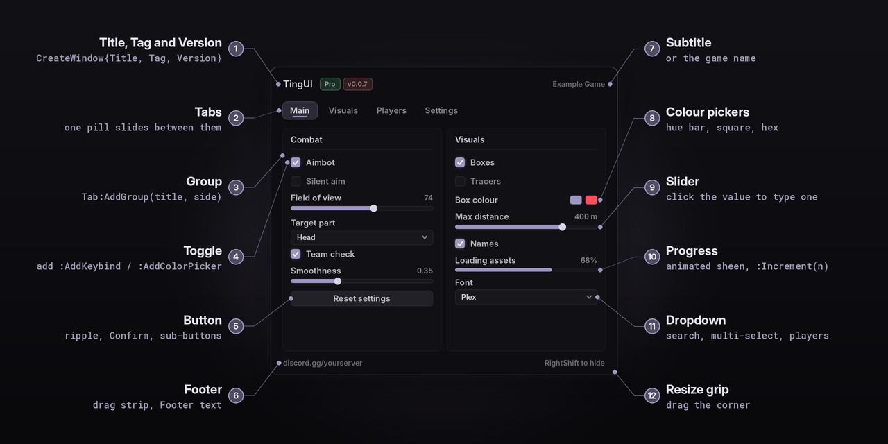
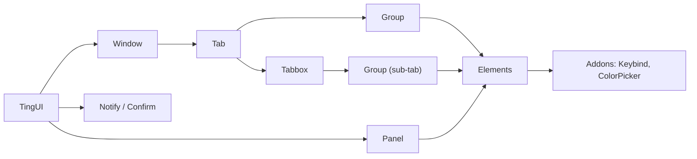

# Getting started

<sub>[Docs](README.md) › Getting started</sub>

TingUI is one Luau file. Load it from an executor with `loadstring`, or drop it into a game as a ModuleScript. Both ways return the same library with the same API.

- [On an executor](#on-an-executor)
- [In a Roblox game](#in-a-roblox-game)
- [Load options](#load-options)
- [Your first window](#your-first-window)
- [How the pieces fit](#how-the-pieces-fit)
- [Safe callbacks](#safe-callbacks)

## On an executor

```lua
-- simplest
local TingUI = loadstring(game:HttpGet("https://raw.githubusercontent.com/Irakli17/Ui-Library-Test/main/TingUI.lua"))()

-- with options, passed straight into the loaded chunk
local TingUI = loadstring(game:HttpGet("https://raw.githubusercontent.com/Irakli17/Ui-Library-Test/main/TingUI.lua"))({
	Id = "MyHub", Theme = "Hologram",
})
```

The sturdiest way is `Loader.lua`. It tries GitHub, then the jsDelivr mirror, then a copy cached on disk. It checks that the download really is TingUI, and it returns `nil` plus an error message instead of crashing:

```lua
local TingUI, err = loadstring(game:HttpGet("https://raw.githubusercontent.com/Irakli17/Ui-Library-Test/main/Loader.lua"))()({
	Id = "MyHub",
	Version = "main",   -- or a tag like "v0.0.7-stable" to pin a release
})
if not TingUI then return warn(err) end
```

> [!TIP]
> Give every script its own `Id`. Re-running a script then replaces **its own** previous UI and leaves other scripts' UIs alone, and each script keeps its configs in its own folder.

You can also set `getgenv().TingUIOptions = {...}` before loading. It's read once and cleared, so the next script starts clean. [Executors](executors.md) covers what TingUI uses from your executor and what happens when something is missing.

## In a Roblox game

`TingUI.lua` is also a plain **ModuleScript**. It needs nothing from your game's hierarchy and only runs on the client.

1. Put `TingUI.lua` in **ReplicatedStorage** as a ModuleScript named `TingUI`. Alternatively, sync it with Rojo (`default.project.json` maps it) or install it with Wally (`TingUI = "irakli17/tingui@0.0.7"`).
2. Require it from a **LocalScript**. StarterPlayerScripts is a good home. Requiring it from a server Script errors with a clear message.

```lua
local TingUI = require(game:GetService("ReplicatedStorage").TingUI)

TingUI:Configure({ Theme = "Ocean", NotifyPosition = "BottomRight" })   -- any time, also before the first window
local Window = TingUI:CreateWindow({ Title = "My Game" })
```

`require` can't take arguments, so there are three other ways to pass options:

| Way | When to use it |
|---|---|
| **Attributes** on the ModuleScript | In the Properties panel, add attributes like `Theme = "Ocean"`, `Id = "MyGame"` or `NoInter = true`. They're read when the module first loads. |
| **`TingUI:Configure(options)`** | After requiring. Takes `Theme`, `Font`, `Parent`, `DisplayOrder`, `Name`, `Folder`, `Storage`, `Scale`, `Hints`, `NotifyErrors`, `Shortcuts`, `ReducedMotion`, `NotifyPosition`, `Icons` and `Textures`. Returns `TingUI`, so you can chain it. |
| **`TingUI.new(options)`** | For a second, fully independent instance with its own GUI, flags, configs and theme. It takes any load option. Without an `Id` it gets a unique one, so it never replaces the first. |

<details>
<summary><b>What's different outside an executor</b></summary>

<br>

| Feature | In a game |
|---|---|
| Configs | Live in memory for the session, unless you give TingUI a storage adapter. `extras/DataStoreStorage.lua` saves them per player in a DataStore (see [Configs](configs.md#datastore-in-a-real-game)). |
| Inter font | Stays Gotham, because downloading a font needs `writefile` and `getcustomasset`. |
| Icons | The crisp vector versions are used, unless you pass `Icons = {gear = "rbxassetid://..."}`. |
| Theme art | Cosmos' nebula and Criminality's brick wall need `Textures = {nebula = "rbxassetid://..."}`. Scenes need nothing and always work. |
| `TingUI:Request` / `TingUI:Clipboard` | Return `nil` / `false`. |

Everything else works the same.
</details>

`dev.project.json` builds a test place with TingUI, the DataStore config server and a small demo LocalScript (`extras/StudioDemo.client.lua`). Run `rojo serve dev.project.json` to try it.

## Load options

Every option is optional. Pass them to `loadstring(...)(options)`, `Loader.lua`, `TingUI.new(options)` or as ModuleScript attributes.

| Option | Default | What it does |
|---|---|---|
| `Id` | `"default"` | Each Id is its own instance. Re-running a script replaces **its own** previous UI and leaves other scripts' UIs alone. |
| `Reuse` | `false` | If an instance with this Id is already running, return it instead of replacing it, so several scripts can share one UI. |
| `Theme` | `"Lavender"` | Start in any [preset](themes.md#the-presets). |
| `Folder` | `"TingUI/<Id>"` | Where configs and the autoload choice are kept. The default `Id` uses `"TingUI"`. |
| `CacheFolder` | `"TingUI"` | Where downloaded fonts, icons and theme art are cached. Shared by every script, so they're only downloaded once. |
| `ThemeFolder` | `"TingUI/themes"` | Where themes saved from the [Theme Studio](theme-studio.md) are kept. Shared by every script, so a theme you make shows up in all of them. |
| `Shell` | on | How this script joins other TingUI scripts on screen: `{Name, Icon}`, or `false` to stay on its own (see [The Shell](shell.md)). |
| `Font` | `"Inter"` | Any font name (see [Fonts](themes.md#fonts)). |
| `Scale` | `1` | UI scale, from 0.6 to 1.6. |
| `NotifyPosition` | `"TopRight"` | `TopRight`, `BottomRight`, `TopLeft` or `BottomLeft`. |
| `NotifyErrors` | `true` | Show a red notification when one of your callbacks errors. |
| `Hints` | `true` | Hover explanations. |
| `ReducedMotion` | `false` | Hold scenes and particles still, and stop glitches, lightning and flicker. Players can also switch it in the config tab. |
| `Shortcuts` | `true` | Ctrl+K (command palette) and Ctrl+Tab (switch tabs). Turn it off if your game uses those keys. |
| `ScaleGuard` | `true` | Remove `UIScale` and `UIAspectRatioConstraint` objects that other scripts put inside TingUI, so the UI keeps its size (see [Stability](stability.md#the-ui-keeps-its-size)). |
| `Parent` | auto | Where the ScreenGui goes. By default it tries `gethui()`, then CoreGui on executors, then the player's PlayerGui. |
| `Storage` | auto | Where configs are kept: executor files when available, otherwise memory. Pass your own adapter (see [Storage](configs.md#storage)). |
| `DisplayOrder`, `Name` | `10000`, `"TingUI"` | ScreenGui properties. The name is `"TingUI_<Id>"` for any other `Id`. |
| `NoInter` | `false` | Skip the one-time Inter font download. |
| `NoImages` | `false` | Skip all image downloads. Vector icons stay, and theme art (nebula, brick and so on) is left out. |
| `AssetBase` | this repo | URL folder holding the icon PNGs (`<AssetBase>/<name>.png`). It's tried before GitHub and jsDelivr. |
| `Icons` | `{}` | Your own image per icon name, for example `{gear = "rbxassetid://123"}`. Also settable later through `TingUI.IconAssets`. |
| `TextureBase` | this repo | URL folder holding the theme textures (`<TextureBase>/<name>.png`), tried first. Defaults to `AssetBase` with `icons/` swapped for `textures/`. |
| `Textures` | `{}` | Your own image per texture name, for example `{nebula = "rbxassetid://123"}`. Also settable through `TingUI.TextureAssets`. |

`Id`, `Reuse`, `NoInter`, `NoImages`, `AssetBase` and `TextureBase` only matter at load time. Use `TingUI.new` if you need different values.

## Your first window

```lua
local Window = TingUI:CreateWindow({
	Title = "My Hub", Tag = "Pro", Version = "v1.0.0", Subtitle = "Game name", Footer = "discord.gg/x",
	MenuKey = Enum.KeyCode.RightShift,   -- shows and hides the window; never triggers shift lock
	Snow = true,                         -- the theme's particles behind the UI
})

local Main = Window:AddTab("Main")
local Combat = Main:AddGroup({ Title = "Combat", Icon = "scan", Side = "Left" })

Combat:AddToggle({ Text = "Enabled", Flag = "Enabled", Description = "Shown when you hover the toggle." })
	:AddKeybind({ Default = Enum.KeyCode.F, Mode = "Toggle", Name = "Enabled" })
Combat:AddSlider({ Text = "Field of view", Min = 10, Max = 120, Default = 70, Flag = "FOV" })
Combat:AddDropdown({ Text = "Target part", Values = { "Head", "Torso" }, Default = "Head", Flag = "Part" })

Window:AddConfigTab("Config")   -- themes, particles, layout, notifications and configs, all built for you
TingUI:LoadAutoload()           -- after building your UI: restores the player's chosen config
```

<p align="center">
  
</p>

> [!TIP]
> You can also describe the whole window as one table and let TingUI build it, then edit a file and watch the window update as you save. See [Layouts and live reload](layouts.md).

## How the pieces fit



Everything you create is a plain Lua object you can keep and change later with `:Set`, `:SetText`, `:SetVisible`, `:SetDisabled`, `:SetDescription` and `:Destroy`. Elements with a `Flag` keep their value in `TingUI.Flags[flag]` and are saved in configs.

## Safe callbacks

Every callback runs in its own thread inside `xpcall`. That covers elements, buttons, notification actions and events. If one errors, the traceback is printed with the element's name and a red "Script error" notification appears. Turn the notification off with `NotifyErrors = false` or in the config tab. The rest of your script keeps running.

---

**Next:** [Windows and layout](windows.md) · [Elements](elements.md) · [Themes](themes.md)
