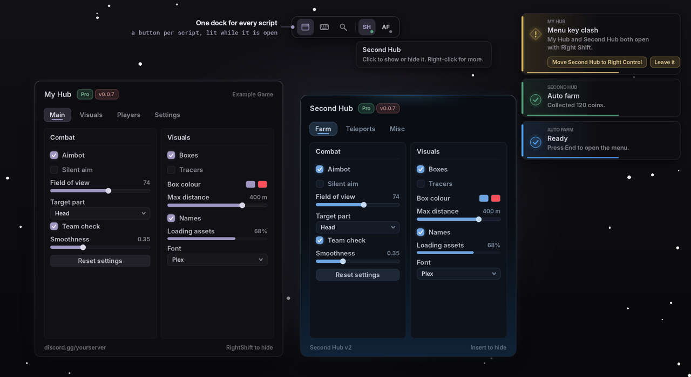

# The Shell

<sub>[Docs](README.md) › The Shell</sub>

Players often run more than one script at a time. Without the Shell, every TingUI script brings its own dock, its own notification stack, its own command palette and its own menu key, and they pile up on top of each other. With the Shell, every TingUI script in the game shares one desktop. You don't have to write anything for this to happen.

<p align="center">
  
</p>

- [What changes when scripts meet](#what-changes-when-scripts-meet)
- [Who hosts](#who-hosts)
- [The taskbar](#the-taskbar)
- [Menu key clashes](#menu-key-clashes)
- [One look for every script](#one-look-for-every-script)
- [Naming your script](#naming-your-script)
- [The Shell API](#the-shell-api)
- [Staying out of it](#staying-out-of-it)

## What changes when scripts meet

When a second TingUI script loads, the two find each other through `getgenv().TingUIInstances`, the registry every TingUI instance already joins. One of them becomes the **host** and the other becomes a **member**.

| Part | On its own | In a Shell |
|---|---|---|
| Dock | Every script shows its own | Only the host's shows. It gains a taskbar button for every other script. |
| Notifications | Every script has its own stack, so cards overlap | Every card goes into the host's stack. A small label on each card names the script that sent it. |
| Command palette | Ctrl+K searches one script | Ctrl+K searches every setting in every script. Each result is tagged with the script it belongs to. |
| Hotkey list | One list per script | One list, with a section for each script |
| Watermark | Every script shows its own | Only the host's shows |
| Backdrop dim and blur | Stacks up when two windows are open | Drawn once, by the first script with a window open |
| Menu keys | Two scripts on the same key both toggle | The host spots it and offers to move one (see [Menu key clashes](#menu-key-clashes)) |

Everything else stays exactly as it was. Each script keeps its own windows, flags, configs, theme and callbacks, and a member's windows open and close with its own menu key as before. When the host unloads, the next script takes over within half a second, and a script that ends up alone again gets its dock and watermark back.

> [!NOTE]
> Everything that crosses between scripts is plain data, called through `pcall`. A script that errors, or runs an older TingUI without the Shell, is simply left out. It can't break the others.

## Who hosts

The host is the first script, in load order, that has a dock and at least one window. A script that creates windows with `Dock = false` takes part in the Shell but never hosts.

Load order is remembered for the session. Re-running a script while you work on it keeps its place, so the same script keeps hosting while you iterate.

## The taskbar

The host's dock grows a divider and one button per other script.

- **The icon** is the script's `Shell.Icon`, or else the icon it gave `CreateWindow` or `SetIcon`. It can be an image or a built-in icon name. A script without one shows its initials.
- **The dot** in its corner lights up while one of the script's windows is open.
- **Left-click** hides that script's open windows, or brings back the ones it hid.
- **Right-click** opens a menu:

| Menu item | What it does |
|---|---|
| Show or Hide | The same as a left-click |
| The script's own dock buttons | Panels, links and anything else it added with `AddDockButton`, since its own dock is hidden |
| Use my theme | Gives that script the host's current look (see [One look for every script](#one-look-for-every-script)) |
| Unload | Unloads that script after a confirmation |

Hovering a button shows the script's name. The taskbar updates by itself as scripts load, unload, rename themselves or change their icon.

## Menu key clashes

Two scripts with the same menu key both open when it's pressed. The host checks for this whenever the scripts change, and shows one notification per clash with a button that fixes it:

> **Menu key clash**\
> My Hub and Second Hub both open with Right Shift.\
> `[Move Second Hub to Right Control]` `[Leave it]`

It also catches a menu key that is another script's keybind, for example a menu on `F` while another script's Fly is bound to `F`.

The fix moves the later script's menu key to the first free key in this order: Right Control, Insert, End, Home, Page Up, Page Down, Right Alt, then F6 to F10. If that script has a config tab, its menu key chip follows, so the new key is what gets saved. Each clash is reported once. Choosing **Leave it** keeps both scripts as they are.

## One look for every script

Each script keeps its own theme, but you can hand one look to all of them:

- From the taskbar: right-click a script and choose **Use my theme**.
- From the [Theme Studio](theme-studio.md): **Use in every script**, on the Share tab.
- From code:

```lua
TingUI.Shell:ApplyThemeToAll()           -- this script's current look, in every other script; returns how many took it
TingUI.Shell:ApplyThemeToAll("Abyss")    -- switch this script to Abyss, then every other script too
```

A built-in theme travels by name. A custom or edited theme travels as a [share code](theme-studio.md#share-codes), so the other script gets exactly the same colours and style even if it has never seen that theme. The other script uses the look for the session without saving it.

## Naming your script

By default a script shows up under its first window's title. Give it a better name, or an icon, in the load options:

```lua
local TingUI = loadstring(game:HttpGet(URL))({
	Id = "MyHub",
	Shell = { Name = "My Hub", Icon = "rbxassetid://1234567" },   -- Icon can also be a built-in icon name like "scan"
})

TingUI.Shell:SetName("My Hub (beta)")   -- or change them later
TingUI.Shell:SetIcon("gear")
```

## The Shell API

Every instance has `TingUI.Shell`, whether or not other scripts are running.

| Call | Returns or does |
|---|---|
| `Shell:Role()` | `"solo"`, `"host"` or `"member"` |
| `Shell:IsHost()` | `true` while this script hosts |
| `Shell:List()` | Every script in the Shell, in load order: `{Id, Name, Icon, Version, Open, Host, Self}` |
| `Shell:Host()` | The host's entry from `List()`, or `nil` when this script is on its own |
| `Shell:SetName(name)`, `Shell:SetIcon(icon)` | How this script shows up on the taskbar |
| `Shell:ApplyThemeTo(script)` | Hand this script's look to one script: an entry from `List()` or its `Id`. Returns `true` when it took it. |
| `Shell:ApplyThemeToAll(name?)` | The same for every script. Returns how many took it. |
| `Shell:SetEnabled(bool)` | Leave or rejoin the Shell while running |
| `Shell:IsEnabled()` | Whether this script takes part |

| Event | Fires with |
|---|---|
| `Shell.Events.Joined` | `{Id, Name, Icon, Version}` when another script arrives |
| `Shell.Events.Left` | The same, when one unloads or leaves |
| `Shell.Events.RoleChanged` | The new role, when this script starts or stops hosting |

```lua
TingUI.Shell.Events.Joined:Connect(function(other)
	TingUI:Notify({ Title = "Welcome", Content = other.Name .. " is running too.", Type = "Info" })
end)
```

## Staying out of it

Load with `Shell = false` and the script behaves exactly as it did before the Shell existed. It keeps its own dock, notifications, palette and hotkey list, and the other scripts don't see it.

```lua
local TingUI = loadstring(game:HttpGet(URL))({ Id = "MyHub", Shell = false })
TingUI.Shell:SetEnabled(false)   -- or step out later, and back in with true
```

---

**Next:** [Theme Studio](theme-studio.md) · [Layouts and live reload](layouts.md)
