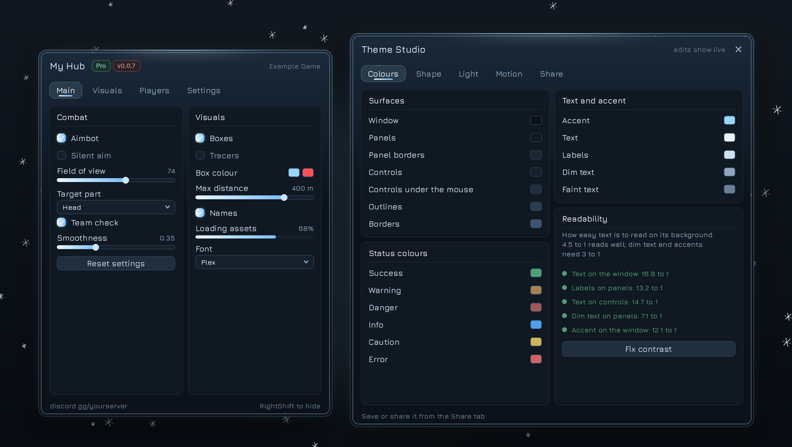

# Theme Studio and share codes

<sub>[Docs](README.md) › Theme Studio</sub>

The Theme Studio is a window for making themes. Every change shows up on your real UI while you make it, the studio tells you when text gets hard to read, and a finished theme becomes a **share code**: one line of text that anyone can paste to install it.

<p align="center">
  
</p>

- [Opening the studio](#opening-the-studio)
- [What you can change](#what-you-can-change)
- [Readability checks](#readability-checks)
- [Saving and your themes](#saving-and-your-themes)
- [Share codes](#share-codes)
- [Why codes are safe to paste](#why-codes-are-safe-to-paste)
- [Code API](#code-api)

## Opening the studio

| From | How |
|---|---|
| The config tab | **Theme** group › **Open Theme Studio** |
| The dock | The palette button that appears once the studio has been opened |
| Code | `TingUI:OpenThemeStudio()`, and `TingUI:CloseThemeStudio()` to close it |

The studio opens beside your main window when the screen has room, and otherwise in the middle of the screen. It has a close button in its header and no menu key of its own, so it never takes a key from your script. Opening it again brings back the same window. It starts from whatever theme is on screen.

Edits are applied a moment after you make them, so dragging a slider or a colour costs a handful of repaints instead of one per pixel. Switching theme anywhere else, such as the config tab's preset list, reloads the studio with that theme.

## What you can change

| Tab | Groups and what's in them |
|---|---|
| **Colours** | **Surfaces**: window, panels, panel borders, controls, controls under the mouse, outlines, borders. **Status colours**: Success, Warning, Danger, Info, Caution, Error. **Text and accent**: the accent and the four text colours. **Readability**: the checks below. |
| **Shape** | **Shape and type**: corner roundness, glow, text size, font, see-through surfaces. **Borders and light**: the turning border's colours, speed and thickness, hard colour bands, an inner line, and the top light. |
| **Light** | **Window light**: tint colour, where it comes from (top, bottom or a drifting aurora) and its strength, plus world blur. **Effects**: scanlines, a drafting grid, dark screen edges, distant lightning, glitches. **Accent**: an accent gradient, a rainbow accent and its speed. |
| **Motion** | **Particles**: show them, their style and colour. **Painted textures**, for themes that came with art. **Scene**: pick a scene, and change its colours: Circuit's traces and current, or Abyss's jellyfish, light shafts and plankton. |
| **Share** | **Save and share**: name, description, save, copy the share code, install a code. **My themes**: your saved themes, Start from, Revert, and Use in every script. |

Every row explains itself when you hover it. Optional effects, such as the inner line or the tint, are switched on with a toggle that remembers the colour you picked.

## Readability checks

The Readability group measures contrast the way the web's accessibility guidelines do (WCAG). Each pair shows its ratio, in green when it reads well and in amber, marked *hard to read*, when it doesn't:

| Check | Needs |
|---|---|
| Text on the window | 4.5 : 1 |
| Labels on panels | 4.5 : 1 |
| Text on controls | 4.5 : 1 |
| Dim text on panels | 3 : 1 |
| Accent on the window | 3 : 1 |

**Fix contrast** moves each failing colour toward white or black, whichever reads better on its background, and only as far as it needs to pass. The same rule is available in code:

```lua
local label = TingUI.Readable(myColor, TingUI.Theme.Group)        -- the nearest colour that reaches 4.5 : 1
local accent = TingUI.Readable(myAccent, TingUI.Theme.Background, 3)
```

## Saving and your themes

**Save to my themes** registers the theme, adds it to every preset list and saves it. Saved themes come back by themselves the next time any of your scripts loads, and they work anywhere a theme name does:

```lua
local TingUI = loadstring(game:HttpGet(URL))({ Theme = "Midnight Mint" })   -- a theme you saved
TingUI:Configure({ Theme = "Midnight Mint" })
TingUI:ApplyPreset("Midnight Mint")
```

They're kept in `TingUI/themes/<name>.tui`, through the same [storage](configs.md#storage) as configs. That folder is shared by every script, so a theme you make in one hub shows up in all of them. Set `ThemeFolder` in the load options to keep a script's themes somewhere else.

| Button | What it does |
|---|---|
| Use | Switch to a saved theme |
| Delete | Remove it, after a confirmation. The theme stays on screen until you pick another. |
| Start from | Load any theme into the studio as a starting point |
| Revert | Go back to the look you had when you opened the studio |
| Use in every script | Give every other TingUI script that's running this look (see [the Shell](shell.md#one-look-for-every-script)) |

Built-in themes can't be overwritten. When you start from one, the name box suggests `"<theme> remix"`, and saving under a built-in's own name is refused with a note to pick another.

> [!NOTE]
> Outside an executor, themes are saved through whatever storage the game uses. With the default in-memory storage they last for the session, and the studio says so when you save. A game with a [DataStore adapter](configs.md#datastore-in-a-real-game) keeps them for good.

## Share codes

**Copy share code** puts the theme on your clipboard as one line:

```text
TUI1:eyJjIjp7IkFjY2VudCI6IjhjYzg3OCIsIkJhY2tncm91bmQiOiIwZTExMGQi...
```

Paste a code into the **Share code** box and press **Install code**. The theme is checked, added to your list, saved and switched to. If your executor can't read the clipboard, the code is also shown in the box so it can be copied by hand.

- A code carries everything the studio can change: the 12 base colours, the 6 status colours and every style key, including the colours and numbers a scene reads.
- Painted textures travel when their images are built into TingUI or uploaded to Roblox (`rbxassetid://`).
- A code for an untouched built-in theme simply switches to that theme. A code for an edited built-in installs as `"<name> (custom)"`, so the original stays as it was.

## Why codes are safe to paste

A share code is data. TingUI never runs anything from it, so a code from a stranger can't touch your game, your files or your script. Before installing a code, TingUI:

- refuses anything that doesn't start with `TUI1:`, is damaged, comes from a newer TingUI, or is longer than 12,000 characters
- keeps only colour keys the theme system knows, as `rrggbb` hex
- checks every style key against its type: numbers are clamped to their range, fonts must be real fonts, and particle styles and scenes must already be registered
- accepts images only as `rbxassetid://` ids or built-in texture names
- strips control characters and `<` `>` from the name and description, and shortens them to 32 and 120 characters

Anything that doesn't fit is dropped. `DecodeTheme` lists what was dropped, so you can see what a code tried to carry.

## Code API

| Call | Returns or does |
|---|---|
| `TingUI:ExportTheme()` | A code for the look on screen right now |
| `TingUI:ExportTheme(name)` | A code for any registered theme |
| `TingUI:ExportTheme({Name, Description})` | The current look, with a name and description in the code |
| `TingUI:DecodeTheme(code)` | `{Name, Description, Colors, Style, Dropped}` without installing anything, or `nil, message` |
| `TingUI:ImportTheme(code, opts?)` | Installs a code and returns the theme's name, or `nil, message`. `opts` is a name, or `{Name, Save = true, Apply = true}`. |
| `TingUI:SaveTheme(name)` | Saves a registered theme. Returns `true`, or `false, message`. |
| `TingUI:ListSavedThemes()` | The names of your saved themes |
| `TingUI:DeleteTheme(name)` | Deletes a saved theme |
| `TingUI.Readable(fg, bg, ratio?)` | `fg`, moved toward white or black until it reaches the ratio (4.5 by default) |
| `TingUI:OpenThemeStudio()`, `CloseThemeStudio()` | Show or hide the studio. `OpenThemeStudio` returns its window. |

```lua
-- a "paste a theme" box in your own UI
group:AddInput({ Text = "Theme code", Placeholder = "TUI1:...", Callback = function(code)
	local name, err = TingUI:ImportTheme(code)
	if name then
		TingUI:Notify({ Title = "Theme installed", Content = name, Type = "Success" })
	else
		TingUI:Notify({ Title = "Couldn't install", Content = err, Type = "Error" })
	end
end })
```

---

**Next:** [Layouts and live reload](layouts.md) · [Themes](themes.md)
