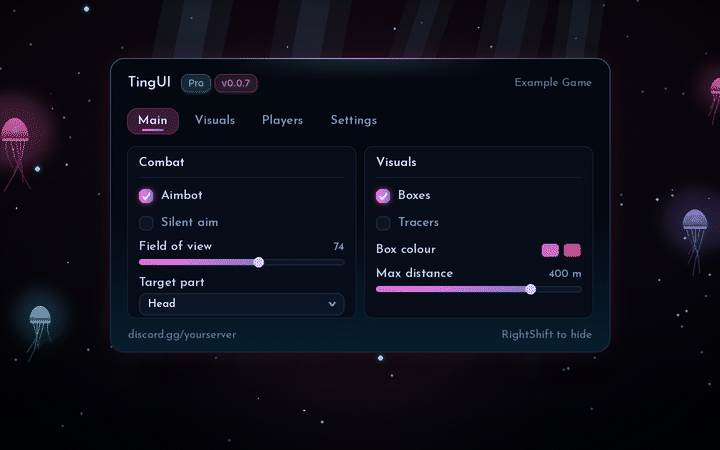
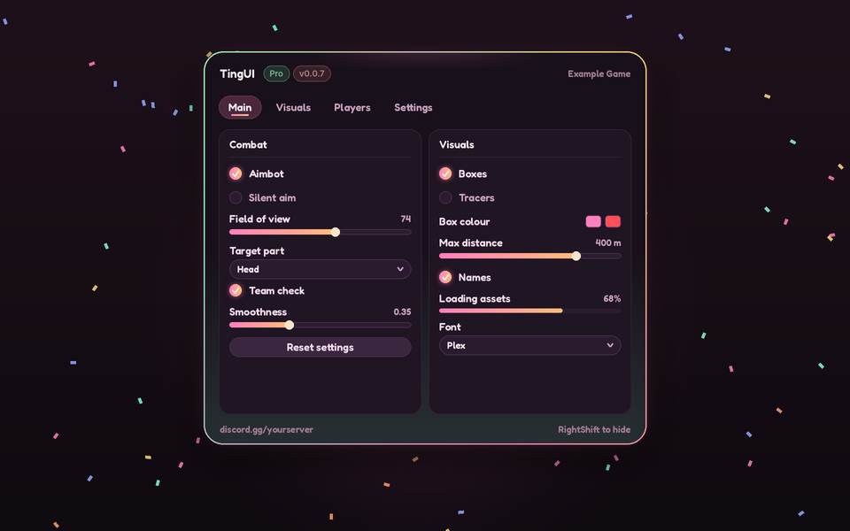
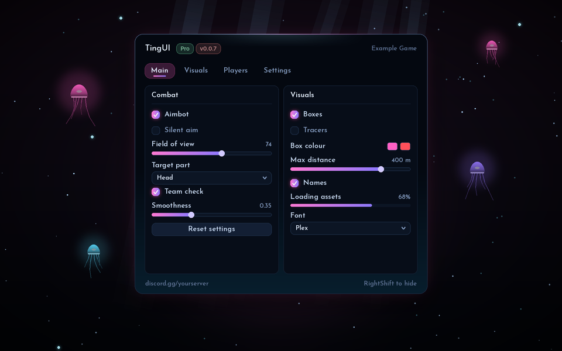
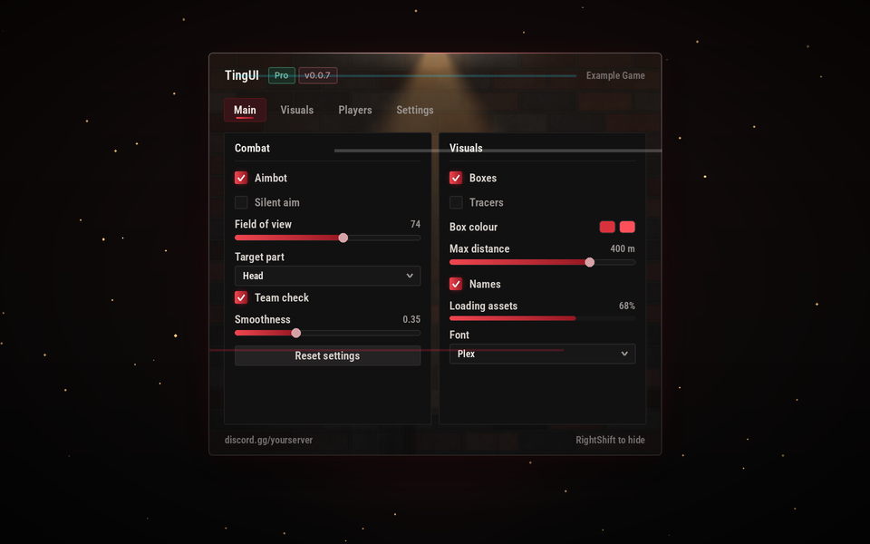
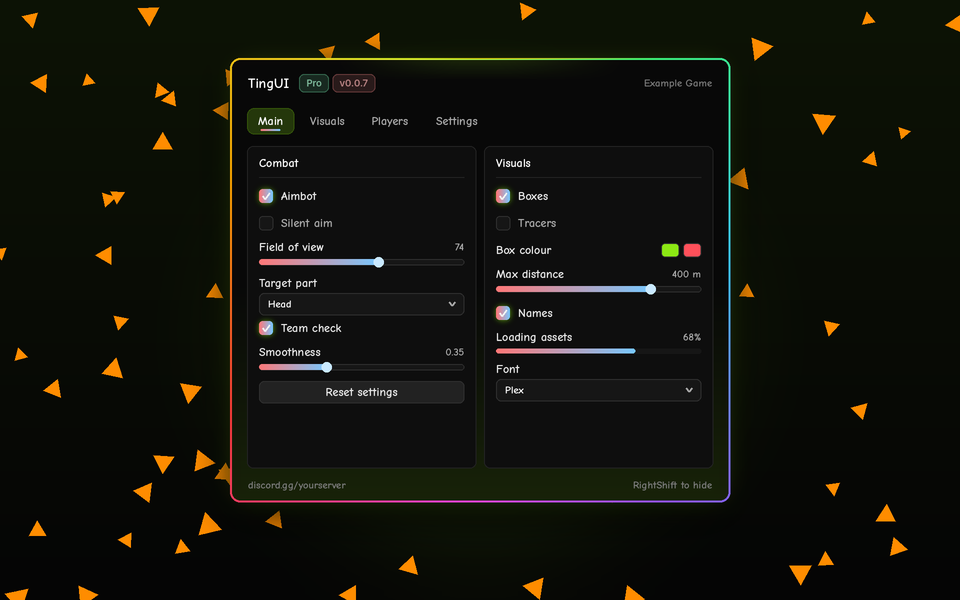

# Themes

<sub>[Docs](README.md) › Themes</sub>

A TingUI theme changes the **shape and feel** of every element, not just its colours. That includes corner roundness, glow strength, the font and text size, the window lighting, borders, accent gradients and particles, and for three themes a whole animated scene. Switching blends all of it over `TingUI.ThemeTransition` seconds (0.3 by default, or **Theme fade** in the config tab). Colours blend, corners morph, glow fades, text dips and comes back in the new font, and the lighting, particles and scenes crossfade.

- [Switching themes](#switching-themes)
- [The presets](#the-presets)
- [Scenes](#scenes)
- [Gallery](#gallery)
- [Reduced motion](#reduced-motion)
- [Style keys](#style-keys)
- [Theme textures](#theme-textures)
- [Particles and backdrop](#particles-and-backdrop)
- [Fonts](#fonts)
- [Scale](#scale)
- [Your own theme](#your-own-theme)
- [Theme Studio and share codes](#theme-studio-and-share-codes)

## Switching themes

```lua
TingUI:ApplyPreset("Abyss")
TingUI:SetTheme({ Accent = Color3.fromRGB(255, 90, 120) })             -- colours only (instant)
TingUI:SetTheme({ Accent = Color3.fromRGB(255, 90, 120) }, 0.4)        -- colours, blended
TingUI:SetStyle({ Radius = 1.4, Glow = 1.3, Font = "Nunito" }, 0.4)    -- shape and feel, blended
```

`SetStyle` replaces the whole style. To change one key and keep the rest, copy the current style first:

```lua
local style = table.clone(TingUI.Style)
style.Scene = "Circuit"          -- borrow a scene for any theme
TingUI:SetStyle(style, 0.4)
```

Lavender is the default, and the config tab lists it as **"Lavender (Default)"**. `TingUI:ApplyPreset("Lavender (Default)")` also works.

## The presets

| Preset | Shape | Font | Surface and border | Accent | Particles | Scene |
|---|---|---|---|---|---|---|
| [Lavender](#lavender) | reference | Inter | flat, as in the reference | solid | Snow | |
| [Ocean](#ocean) | rounder | Inter | deep-water glow from below, cyan-blue top light | solid | Bubbles rising | |
| [Rose](#rose) | very round, strong glow | Inter | pink haze from above, pink-peach top light | solid | Petals spinning down | |
| [Sunset](#sunset) | reference | Inter | warm glow from below | solid | Embers rising | |
| [Mono](#mono) | sharp, no glow | RobotoMono | scanlines | solid | Glyph rain | |
| [Frost](#frost) | round | Jura | icy top light, frosted inner border | white-to-ice gradient | Spinning ice crystals | |
| [Royal](#royal) | sharp-ish | Merriweather (serif) | gold top light, gilded double border | gold gradient | Glinting sparkles | |
| [Candy](#candy) | extra round, big glow | Fredoka One | mint glow from below, slow pastel border | pink-to-peach gradient | Tumbling confetti | |
| [Cosmos](#cosmos) | round | Titillium Web | drifting nebula and parallax stars in the window, nebula across the screen, turning aurora border | violet-to-cyan gradient | Galaxy: stars, shooting stars, comets | |
| [Storm](#storm) | reference | Oswald (condensed) | steel top light | solid | Slanted rain and distant lightning | |
| [Blueprint](#blueprint) | sharp | Patrick Hand | drafting grid, white inner line | solid | Pencil marks | |
| [Hazard](#hazard) | square | Sarpanch | static yellow and black striped border at 45° | solid | Sparks arcing under gravity | |
| [Glass](#glass) | very round | Nunito | translucent, blurred surfaces, white inner line | gradient | Soft bokeh | |
| [Hologram](#hologram) | crisp | Michroma | cyan projection: scanlines, see-through surface, slow scanning aura | ice-to-cyan gradient | Holo: data motes | **Hologram** |
| [Circuit](#circuit) | sharp | Ubuntu | graphite board, copper inner line, amber top light | amber gradient | Static: electric arcs | **Circuit** |
| [Abyss](#abyss) | round, deep glow | Josefin Sans | dark water lit from below, vignette | pink-to-violet gradient | Marine snow | **Abyss** |
| [Criminality](#criminality) | tight | Roboto Condensed | brick wall under a flickering street lamp, vignette, glitching title and screen | blood-red gradient | Grit: dust in the light, blade glints | |
| [MLG](#mlg) | reference, big glow | Cartoon (comic) | fast rainbow border, green glow from below | rainbow, cycling | Doritos, hitmarkers, rainbow words | |

## Scenes

A scene is living artwork a theme draws in and around each window. It reacts to the player: a **click** on the window, a **tab switch** and the window **opening** each get their own response. Scenes are built entirely from plain frames, so they need no uploaded images and work in every executor and every game.

They're also careful with performance and safety. A scene pauses while its window is hidden, crossfades in and out with theme blends and is destroyed once no theme uses it. **Reduced motion** holds it still. If a scene ever errors, it's switched off with one warning and the rest of the UI carries on.

### Hologram scene


| When | What happens |
|---|---|
| Always | A projector beam glows under the window and telemetry readouts tick beside it. A scan line sweeps the page, and the image tears for an instant now and then. |
| Open | Corner brackets fly in and lock onto the window with a slight overshoot. |
| Tab | The scan line restarts from the top of the new page. |
| Click | A hexagon ripples out from where you clicked. |

### Circuit scene


| When | What happens |
|---|---|
| Always | The window is a chip on a board. Copper traces run out from pins on all four edges, current pulses race along them and vias flash as they pass. |
| Pointer | Pins near your cursor warm up. |
| Open, Tab | A boot chase runs around every pin in turn. |
| Click | A burst fires down the nearest traces, with a square solder flash where you clicked. |

### Abyss scene



| When | What happens |
|---|---|
| Always | Light shafts fall from far above, and bioluminescent jellyfish pulse their way up around the window, trailing tentacles. |
| Pointer | Plankton glow and drift aside as your cursor passes. |
| Open | The light shafts flare and every jellyfish flashes. |
| Tab | The light shafts flare. |
| Click | Light blooms where you clicked, plankton scatter and nearby jellyfish flinch away. |

Scenes take their colours from the theme, so they follow your accent. Circuit also reads `TraceColor` and `EnergyColor`, and Abyss reads `JellyColors`, `RayColor` and `PlanktonColor` (see [Style keys](#style-keys)). To write your own, see [Scenes in Extending](extending.md#scenes).

## Gallery

<table>
  <tr>
    <td width="50%" valign="top">

### Lavender


The reference look: soft lilac and snow.

</td>
    <td width="50%" valign="top">

### Ocean


Rounder, with a deep-water glow and rising bubbles.

</td>
  </tr>
  <tr>
    <td valign="top">

### Rose


Extra round and glowy, with drifting petals.

</td>
    <td valign="top">

### Sunset


A warm glow from below and rising embers.

</td>
  </tr>
  <tr>
    <td valign="top">

### Mono


Sharp corners, no glow, monospace type, scanlines and glyph rain.

</td>
    <td valign="top">

### Frost


Pale ice, thin rounded type, a frosted double border and spinning ice crystals.

</td>
  </tr>
  <tr>
    <td valign="top">

### Royal


Midnight navy and gold, serif type, a gilded double border and glinting sparkles.

</td>
    <td valign="top">

### Candy


Bubblegum pastels, a soft rounded font, extra-round shapes and tumbling confetti.

</td>
  </tr>
  <tr>
    <td valign="top">

### Cosmos


Deep space: drifting nebula clouds over a parallax star layer, a turning aurora border, shooting stars and comets.

</td>
    <td valign="top">

### Storm


Slate and steel, condensed type, slanted rain and distant lightning.

</td>
  </tr>
  <tr>
    <td valign="top">

### Blueprint


Drafting paper: navy blue, a white grid, a ruled double border, handwritten labels and drafting marks.

</td>
    <td valign="top">

### Hazard


Industrial yellow and black, a striped warning-tape border, square corners and welding sparks.

</td>
  </tr>
  <tr>
    <td valign="top">

### Glass


See-through frosted surfaces over a blurred world, soft rounded type and drifting bokeh lights.

</td>
    <td valign="top">

### Hologram


A cyan light projection with a live [scene](#scenes): locking brackets, a sweeping scan line, image tears and hexagon ripples.

</td>
  </tr>
  <tr>
    <td valign="top">

### Circuit


The window is a chip on a circuit board, with current racing down its traces. It has a live [scene](#scenes).

</td>
    <td valign="top">

### Abyss


The deep sea: light shafts, pulsing jellyfish and glowing plankton. It has a live [scene](#scenes).

</td>
  </tr>
  <tr>
    <td valign="top">

### Criminality


A grimy brick alley under a flickering street lamp, blood-red accents, a glitching title and dust in the light.

</td>
    <td valign="top">

### MLG


A comic font, a fast rainbow border, spinning doritos, hitmarkers and rainbow words. WOW.

</td>
  </tr>
</table>

<sub>These previews are drawn by `tools/build_previews.py` straight from the presets in `TingUI.lua`, so they always match the code. In-game rendering differs slightly.</sub>

## Reduced motion

Some players find constant motion tiring, and some games want the UI quiet. **Reduced motion** holds scenes and particles still and stops glitches, lightning, flicker, aura rotation and texture drift. Colours, themes and every control keep working.

```lua
TingUI:SetReducedMotion(true)      -- also a "Reduce motion" toggle in the config tab's Effects group
-- or load with { ReducedMotion = true }, or TingUI:Configure({ ReducedMotion = true })
```

It's saved in configs like any other setting, under the flag `TingUI_ReducedMotion`.

## Style keys

Every key is optional.

| Key | What it does |
|---|---|
| `Radius` | Corner scale. `1` is the reference. |
| `Glow` | Glow strength. `0` turns it off. |
| `Font`, `TextScale` | Font name and text size multiplier (see [Fonts](#fonts)). |
| `Particles`, `ParticleColor` | The theme's particle style and colour. |
| `Tint`, `TintPlace`, `TintAmount` | Window lighting: a colour, where it sits (`"Top"`, `"Bottom"` or `"Aurora"`) and how strong it is. |
| `TopLine = {c1, c2}` | A light line along the top edge. |
| `Scanlines` | CRT-style lines over the window. |
| `Aura = {c1, c2, ...}`, `AuraSpeed`, `AuraThickness` | A gradient border that turns. |
| `AuraHard`, `AuraRotation` | Hard colour bands instead of a smooth gradient, and the border angle when `AuraSpeed = 0`. |
| `InnerLine = Color3` | A second, inner border. |
| `AccentGradient = {c1, c2}` | Toggles, sliders and progress bars fill with a gradient. |
| `AccentCycle`, `CycleSpeed` | The accent cycles through the spectrum, and how fast. |
| `Lightning` | Distant lightning flashes behind the UI. |
| `Grid`, `GridColor` | A drafting grid over the window. |
| `Vignette = true` | Darkens the screen edges. |
| `SurfaceTransparency` | See-through surfaces (`0-1`). |
| `Blur` | World blur behind the UI. |
| `Texture`, `BackdropTexture`, `Glitch` | Painted art and glitches (see [Theme textures](#theme-textures)). |
| `Scene` | A [scene](#scenes) name: `"Hologram"`, `"Circuit"`, `"Abyss"` or one you registered. |
| `TraceColor`, `EnergyColor` | Circuit's copper traces and current. They default to `Border` and `Accent`. |
| `JellyColors = {c1, c2, ...}`, `RayColor`, `PlanktonColor` | Abyss' jellyfish, light shafts and plankton. They default to `Accent`, `Text` and `Accent`. |

**Theme keys** (colours): `Background, Group, GroupBorder, Control, ControlHover, Border, Outline, Text, Label, TextDim, TextMuted, Chip, ChipText, Accent, AccentText, AccentBorder, Toggle, TabActive, Success, Warning, Danger, Info, Caution, Error`. Setting `Accent` or `Background` also derives `AccentText`, `AccentBorder`, `Toggle` and `TabActive` unless you pass them.

## Theme textures

Some themes paint real art into the window. Cosmos has drifting nebula clouds over a parallax star layer, with the nebula faintly across the whole screen. Criminality has a grimy brick wall lit by a flickering street lamp. The images are high-resolution PNGs generated by `tools/build_textures.py` (procedural, nothing copied) and stored in `assets/textures/`. They're downloaded the first time a theme needs them and cached in `<CacheFolder>/textures/v1/`. Until they arrive, or without `writefile` and `getcustomasset`, the theme simply shows without its art.

```lua
TingUI:RegisterTheme("Deep Field", {
	Accent = Color3.fromRGB(120, 200, 255), Background = Color3.fromRGB(6, 8, 16),
	Style = {
		Particles = "Galaxy",
		Texture = {
			{ Image = "nebula", Transparency = 0.5, Drift = 0.03, Zoom = 0.9 },                 -- slow pan, never jumps
			{ Image = "stars", Transparency = 0.15, Drift = 0.06, Pulse = 0.25 },              -- breathes gently
			{ Image = "lamp", Mode = "Lamp", Color = Color3.fromRGB(255, 184, 105), Flicker = true }, -- light cone from the top
			{ Image = "rbxassetid://1234567", Transparency = 0.8 },                             -- any image works
		},
		BackdropTexture = { Image = "nebula", Transparency = 0.85, Drift = 0.01 },          -- art across the whole screen
		Glitch = true,                                                                        -- title and screen glitch now and then
	},
})
```

| Layer key | What it does |
|---|---|
| `Image` | A built-in texture name or any image id. |
| `Transparency` | `0-1`. |
| `Drift` | Pan speed. `0` holds it still. |
| `Zoom` | Image pixels per screen pixel. |
| `Pulse` | How much it breathes. |
| `Color` | A tint. |
| `Mode` | `"Fill"` (the default), or `"Lamp"` for a cone of light from the top edge. |
| `Flicker` | A failing street lamp. |

Layers crossfade when you switch themes.

## Particles and backdrop

```lua
TingUI:SetSnow(true, { Count = 100, Speed = 1.5, Kind = "Theme" })
TingUI:SetParticles("Confetti")
TingUI:SetSnowOptions({ Count = 50 })
TingUI:SetBackdrop({ Dim = 0.5, Blur = 12 })
```

| Kind | Looks like |
|---|---|
| `Theme` | Whatever the active theme ships with |
| `Snow`, `Bubbles`, `Petals`, `Embers`, `Fireflies`, `Stars`, `Rain`, `Leaves` | What they say |
| `Glyphs` | Falling code characters |
| `Confetti` | Tumbling paper |
| `Sparkles`, `Crystals` | Glints and spinning ice |
| `Starfield` | Stars with shooting stars |
| `Neon` | Glowing streaks |
| `Drafting` | Pencil marks |
| `FilmGrain` | Old film |
| `Sparks` | Sparks arcing under gravity |
| `Bokeh` | Soft out-of-focus lights |
| `Bats` | Flapping bats |
| `Galaxy` | Parallax stars, spiked bright stars, shooting stars and comets |
| `Grit` | Dust in lamp light, screen glitches and a blade glint |
| `MLG` | Spinning doritos, hitmarkers and rainbow words |
| `Holo` | Data motes drifting up, flickering like a weak signal |
| `Static` | Tiny electric arcs that crackle for an instant, then jump elsewhere |
| `MarineSnow` | Flecks sinking slowly through dark water, a few glowing faintly |

Switching kind, amount or theme **crossfades** the old particles out and the new ones in. The whole backdrop fades in when a window opens and out when the last one closes. Register your own with [`RegisterParticles`](extending.md#particles).

## Fonts

Inter is downloaded once from GitHub into `<CacheFolder>/fonts`, which needs `writefile` and `getcustomasset`. Until it's ready, or if your executor can't do it, Gotham is used. `"Mono"` means RobotoMono. Any other name is looked up as a built-in Roblox font, for example `Michroma`, `Jura`, `Merriweather`, `FredokaOne`, `JosefinSans`, `TitilliumWeb`, `Oswald`, `Ubuntu`, `Nunito` or `SourceSans`. Unknown names fall back to Gotham.

```lua
TingUI:SetFont("Michroma", 0.35)   -- optional fade in seconds
```

## Scale

```lua
TingUI:SetScale(1.15)   -- windows, panels and popups, from 0.6 to 1.6
```

The scale is TingUI's own and stays exactly what you set. Other scripts can't change it by inserting a `UIScale`, and windows keep their size even when TingUI is required before the screen is ready. [Stability](stability.md#the-ui-keeps-its-size) explains how.

## Your own theme

```lua
TingUI:RegisterTheme("Matcha", {
	Accent = Color3.fromRGB(140, 200, 120), Background = Color3.fromRGB(14, 17, 13), Group = Color3.fromRGB(18, 22, 17),
	Style = { Radius = 1.3, Font = "Nunito", Particles = "Petals", ParticleColor = Color3.fromRGB(190, 230, 160),
		Tint = Color3.fromRGB(110, 180, 90), TintPlace = "Bottom",
		AccentGradient = { Color3.fromRGB(170, 230, 140), Color3.fromRGB(90, 160, 90) } },
}, "Soft greens and drifting leaves.")   -- shown in the config tab's Preset dropdown
```

Add `Scene = "Abyss"` (or your own) to the style to give it a living backdrop.

## Theme Studio and share codes

You don't have to write themes by hand. The **Theme Studio** (config tab › Theme › **Open Theme Studio**, or `TingUI:OpenThemeStudio()`) edits every colour and style key on this page live, checks that text stays readable, and saves your themes so they show up in every script. A finished theme becomes a **share code** that anyone can paste to install it:

```lua
local code = TingUI:ExportTheme()     -- "TUI1:eyJjIjp7..."
TingUI:ImportTheme(code)              -- checked, saved and applied; codes are data only, so they're safe to paste
```

See [Theme Studio and share codes](theme-studio.md).

---

**Next:** [Configs](configs.md) · [Extending](extending.md)
